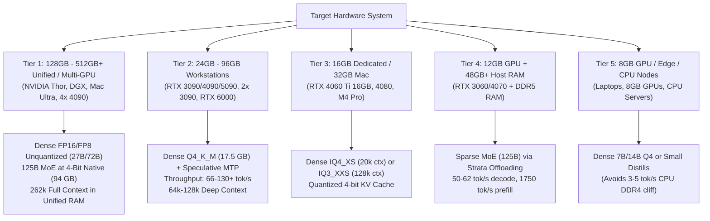
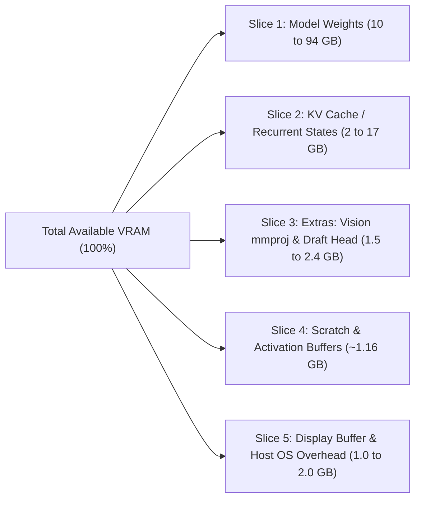

# Universal Local AI Deployment & Hardware Sizing Guide
**Authoritative Architectural Reference, Empirical Benchmarks & Autonomous LLM Execution Runbook**
*Universal Guide for Any Hardware: From Enterprise Clusters & 128GB Unified Dev Kits (NVIDIA Thor, DGX, Mac Ultra) to Consumer Multi-GPU & Desktop Rigs*

---

## Table of Contents
1. [Universal Hardware Sizing & Deployment Hierarchy](#1-universal-hardware-sizing--deployment-hierarchy)
   - [Tier 1: Enterprise & Unified Memory (128GB – 512GB+)](#tier-1-enterprise--unified-memory-workstations-128gb--512gb)
   - [Tier 2: High-VRAM Workstations & Multi-GPU (24GB – 96GB)](#tier-2-high-vram-workstations--multi-gpu-24gb--96gb)
   - [Tier 3: Mid-VRAM Systems (16GB GPUs & 32GB Macs)](#tier-3-mid-vram-systems-16gb-gpus--32gb-macs)
   - [Tier 4: Hybrid Offloading & Desktop Systems (12GB GPUs + RAM)](#tier-4-hybrid-offloading--desktop-systems-12gb-gpus--host-ram)
   - [Tier 5: Constrained / Edge / CPU Systems (8GB GPUs & CPU Nodes)](#tier-5-constrained--edge--cpu-systems-8gb-gpus--cpu-nodes)
2. [Verified Model Capabilities & Benchmark Scorecard](#2-verified-model-capabilities--benchmark-scorecard)
   - [SWE-bench Pro & LiveCodeBench Leadership](#swe-bench-pro--livecodebench-leadership)
   - [Benchmark Summary Table vs Frontier Models](#benchmark-summary-table-vs-frontier-models)
   - [Thinking Effort Hierarchy (`low`, `medium`, `high`, `xhigh`)](#thinking-effort-hierarchy)
3. [Deep Architecture Breakdown: How Modern Models Scale](#3-deep-architecture-breakdown-how-modern-models-scale)
   - [Hybrid Attention: Gated DeltaNet (GDN) + QSA (The 3:1 Layer Ratio)](#hybrid-attention-gated-deltanet-gdn--qsa-the-31-layer-ratio)
   - [Predictive Lookup Embedding (PLE): The 51B N-Gram Table](#predictive-lookup-embedding-ple-the-51b-n-gram-table)
   - [Gated Residuals (GR) & Cross-Layer Stability](#gated-residuals-gr--cross-layer-stability)
4. [The 5 Hardware Memory Slices & Theoretical Foundations](#4-the-5-hardware-memory-slices--theoretical-foundations)
   - [Slice 1: Model Weights & Quantization Precision](#slice-1-model-weights--quantization-precision)
   - [Slice 2: KV Cache & The 157MB Recurrent State](#slice-2-kv-cache--the-157mb-recurrent-state)
   - [Slice 3: Extras (Vision mmproj & Speculative Draft Head)](#slice-3-extras-vision-adapter--speculative-draft-head)
   - [Slice 4: Scratch Space & State Buffers](#slice-4-scratch-space--state-buffers)
   - [Slice 5: Display Buffer & Host OS Overhead](#slice-5-display-buffer--host-os-overhead)
   - [The Memory Bandwidth Decoding Law](#the-memory-bandwidth-decoding-law)
5. [Inference Engine Matrix: TensorRT-LLM vs vLLM vs llama.cpp vs Strata vs Gufo](#5-inference-engine-matrix-tensorrt-llm-vs-vllm-vs-llamacpp-vs-strata-vs-gufo)
6. [Specialized Hardware Architecture Blueprints](#6-specialized-hardware-architecture-blueprints)
   - [Blueprint A: NVIDIA DRIVE / Jetson Thor (128GB Unified LPDDR5x + Blackwell)](#blueprint-a-nvidia-drive--jetson-thor-128gb-unified-lpddr5x--blackwell)
   - [Blueprint B: Multi-GPU Clusters (2x / 4x / 8x RTX 3090, 4090, A6000, H100)](#blueprint-b-multi-gpu-clusters-2x--4x--8x-rtx-3090-4090-a6000-h100)
   - [Blueprint C: Apple Silicon Mac Studio (M-Series Max/Ultra 64GB - 512GB)](#blueprint-c-apple-silicon-mac-studio-m-series-maxultra-64gb---512gb)
   - [Blueprint D: High-End Single GPU Workstations (24GB - 32GB VRAM)](#blueprint-d-high-end-single-gpu-workstations-24gb---32gb-vram)
   - [Blueprint E: Discrete GPU + DDR5 RAM Offloading via Strata](#blueprint-e-discrete-gpu--ddr5-ram-offloading-via-strata)
7. [Fixing Server Defaults: The 4K Context & Reasoning Traps](#7-fixing-server-defaults-the-4k-context--reasoning-traps)
8. [Autonomous LLM & Agent Runbook (Claude Code / Codex / Antigravity CLI)](#8-autonomous-llm--agent-runbook-claude-code--codex--antigravity-cli)
9. [Official Download Sources & Repository Index](#9-official-download-sources--repository-index)
10. [Repository Structure & Turnkey Scripts](#10-repository-structure--turnkey-scripts)

---

## 1. Universal Hardware Sizing & Deployment Hierarchy

This framework is completely unconstrained by hardware form factor. Model selection and quantization precision are dictated solely by total addressable high-speed memory and execution bandwidth.



---

### Tier 1: Enterprise & Unified Memory Workstations (128GB – 512GB+)
* **Hardware Examples:** NVIDIA DRIVE / Jetson Thor (128GB Unified LPDDR5x), NVIDIA DGX / Spark, Apple Mac Studio M-Series Ultra (128GB–512GB), AMD Strix Halo / EPYC (128GB–256GB), 4x–8x RTX 4090 / A6000 / H100 clusters.
* **Target Deployments:**
  1. **Qwen 3.8 27B Unquantized FP16 (55.6 GB) or Blackwell FP8 (27.8 GB):**
     - Absolute zero precision loss.
     - Runs the full native **262,144-token context window** entirely in GPU-addressable memory.
     - Throughput: **50–90 tokens/sec** decode, **1,800+ tokens/sec** prompt prefill.
  2. **Qwen 3.8 Flash-Next (125B MoE) at 4-bit Native (`Q4_K_M`, ~94 GB) or FP8:**
     - The entire 94 GB model (active 6B weights + 51B PLE lookup table) loads directly into unified memory with zero PCIe bottlenecks.
     - 131,072 context window with 25+ GB head-room for activation buffers.

---

### Tier 2: High-VRAM Workstations & Multi-GPU (24GB – 96GB)
* **Hardware Examples:** NVIDIA RTX 3090 (24GB), RTX 4090 (24GB), RTX 5090 (32GB), RTX 6000 Ada (48GB), Dual RTX 3090s (48GB), Mac Studio 64GB–96GB.
* **Target Deployments:**
  1. **Qwen 3.8 27B `Q4_K_M` (16.5–17.5 GB) + Multi-Token Prediction (MTP) Draft Head:**
     - The Performance Benchmark Gold Standard.
     - Verifies 2–3 tokens per weight read pass.
     - Throughput: **66–72 tokens/sec** (base) and up to **130+ tokens/sec** with N-gram stacking on coding workloads.
     - Context Window: **65,536 to 131,072 tokens** using 8-bit KV cache (`q8_0`).
  2. **Qwen 3.8 27B `Q8_0` (28.5 GB):** Fits on 32GB+ cards (RTX 5090, dual-GPU, or 48GB cards) for near-FP16 fidelity.

---

### Tier 3: Mid-VRAM Systems (16GB GPUs & 32GB Macs)
* **Hardware Examples:** RTX 4060 Ti 16GB, RTX 4080 16GB, Apple MacBook Pro M-series 32GB.
* **Target Deployments:**
  1. **Qwen 3.8 27B `IQ4_XS` (14.25 GB):** Maximum 4-bit accuracy for contexts up to 20,000 tokens.
  2. **Qwen 3.8 27B `IQ3_XXS` (11.0 GB):** Ultra-compressed 3-bit quant enabling massive **131,072 context** when paired with 4-bit KV cache (`q4_0`). Throughput: **25–35 tokens/sec**.

---

### Tier 4: Hybrid Offloading & Desktop Systems (12GB GPUs + Host RAM)
* **Hardware Examples:** RTX 3060 12GB, RTX 4070 12GB paired with 48GB–64GB DDR4/DDR5 host RAM.
* **Target Deployments:**
  1. **Qwen 3.8 Flash-Next (125B MoE) 3-bit via Strata:**
     - Keeps active compute weights (~6B params $pprox$ 10.5 GB) in GPU VRAM while streaming the 51B PLE lookup table over PCIe.
     - Achieves **50–62 tokens/sec decode** and **1,750 tokens/sec prefill** at 32k context.
  2. **Qwen 3.8 27B `IQ3_XXS`:** Strictly for short contexts (8k–16k tokens) with headless display.

---

### Tier 5: Constrained / Edge / CPU Systems (8GB GPUs & CPU Nodes)
* **Hardware Examples:** RTX 4060 8GB, RTX 3050, Apple Silicon 16GB, multi-core CPU servers (AVX-512).
* **Target Deployments:**
  - Running a dense 27B model on 8GB forces layer offloading into system memory (DDR4 @ 51 GB/s), causing generation speed to collapse to **3–5 tokens/sec**.
  - **Recommendation:** Deploy **Qwen 2.5 Coder 7B** or **Qwen 3.8 14B Q4_K_M**, which fit 100% inside 8GB VRAM and execute at 45–60 tokens/sec.

---

## 2. Verified Model Capabilities & Benchmark Scorecard

Empirical evaluations across the coding and agentic AI ecosystem show that Alibaba's Qwen 3.8 architecture represents a significant step change in open-weight autonomous capabilities.

### SWE-bench Pro & LiveCodeBench Leadership
* **SWE-bench Pro (61.7%):** Tested using the official Claude Code test harness (`temperature=1.0`, `top_p=0.95`, native 256K context). Qwen 3.8 27B establishes a new benchmark for open-weights, outperforming proprietary checkpoints such as Claude Opus 4.6 Max (53.4%) and its predecessor Qwen 3.6 27B (53.5%).
* **LiveCodeBench v6 (90.3%):** Measures rigorous competitive programming problem-solving without data contamination.
* **Terminal Bench 2.1 (73.0%):** Measures autonomous multi-step bash execution, git conflict resolution, debugging, and sysadmin tasks.
* **OSWorld-Verified (84.3%):** Evaluates multi-modal agentic computer interaction, GUI navigation, and visual tool use.

### Benchmark Summary Table vs Frontier Models

| Model | Model Scale / Type | SWE-bench Pro | LiveCodeBench v6 | Terminal Bench 2.1 | OSWorld-Verified | Native Context |
| :--- | :--- | :--- | :--- | :--- | :--- | :--- |
| **Qwen 3.8 27B** | 27.8B Dense (Hybrid GDN) | **61.7%** | **90.3%** | **73.0%** | **84.3%** | 262k |
| **Claude Opus 4.6 Max** | Proprietary Frontier | 53.4% | 88.7% | 71.2% | 81.0% | 200k |
| **Qwen 3.6 27B** | 27B Dense | 53.5% | 83.9% | 64.8% | 74.2% | 128k |
| **Qwen 2.5 Coder 32B** | 32.5B Standard Attention | 48.2% | 79.5% | 58.1% | N/A (Text) | 128k |
| **DeepSeek-Coder V2 236B** | 236B MoE (21B active) | 52.8% | 84.1% | 66.4% | N/A (Text) | 128k |

### Thinking Effort Hierarchy
Qwen 3.8 incorporates an integrated reasoning loop that can be dynamically tuned to prevent the model from wasting tokens on trivial questions:
1. **`xhigh` (Default Evaluation Mode):** Exhaustive multi-branch reasoning. Emits up to 20,000–30,000 tokens of internal chain-of-thought. Required for 61.7% SWE-bench Pro scores.
2. **`high`:** Full architectural reasoning for complex refactors and algorithm synthesis (5k–15k thinking tokens).
3. **`medium` (Recommended for Local Dev):** Concise chain-of-thought (1k–4k thinking tokens). Solves standard bug fixes and unit tests without stalling.
4. **`low`:** Rapid deterministic responses (100–500 thinking tokens). Ideal for CLI completions and routine file updates.

---

## 3. Deep Architecture Breakdown: How Modern Models Scale

### Hybrid Attention: Gated DeltaNet (GDN) + QSA (The 3:1 Layer Ratio)
Standard Transformers suffer from quadratic memory growth ($O(N^2)$) as conversation length increases. Qwen 3.8 solves this by replacing standard attention across **75% of the network**:

```text
Layer Pattern (Repeating 4-layer block across 64 layers):
[Layer N+0]: Gated DeltaNet (Linear Attention - O(1) Memory State)
[Layer N+1]: Gated DeltaNet (Linear Attention - O(1) Memory State)
[Layer N+2]: Gated DeltaNet (Linear Attention - O(1) Memory State)
[Layer N+3]: Qwen Sparse Attention (Full Softmax Attention - KV Cache)
```

1. **48 Gated DeltaNet (GDN) Layers:**
   - Employs the **Delta Rule** ($\Delta$-Rule): Rather than infinitely accumulating tokens, it subtracts stale memory associations before writing new state updates.
   - Operates with an $O(1)$ memory complexity per token.
   - Each GDN layer maintains a running state buffer of **~3.27 MB**.
   - Total memory for all 48 linear layers: $48 	imes 3.27	ext{ MB} pprox \mathbf{157	ext{ MB}}$ **fixed permanently**, whether your prompt is 10 tokens or 260,000 tokens!
2. **16 Qwen Sparse Attention (QSA) Layers:**
   - Retain full global softmax attention with Grouped-Query Attention (GQA) and RoPE.
   - Index context at a micro-block level, drastically reducing long-context retrieval latency.
   - Only these 16 layers accumulate a per-token KV cache ($pprox 64	ext{ KB}$ per token at FP16).

### Predictive Lookup Embedding (PLE): The 51B N-Gram Table
In **Qwen 3.8 Flash-Next (125B MoE)**, Alibaba added a **51-billion parameter Predictive Lookup Embedding (PLE)** table:
- Evaluates local n-gram sequences (bigrams and trigrams) to predict common syntax and token clusters.
- Because lookup operations are sparse and non-differentiable during inference, the entire 51B table can be **asynchronously offloaded to host system RAM over PCIe 4.0/5.0** or even PCIe NVMe SSDs without blocking the GPU's active compute pipeline.

### Gated Residuals (GR) & Cross-Layer Stability
Qwen 3.8 expands the conventional single residual stream into 4 separate gated pathways governed by dynamic data-dependent read/write gates. This prevents gradient explosion in long contexts (up to 1M with YaRN) and ensures consistent reasoning quality throughout deep agent trajectories.

---

## 4. The 5 Hardware Memory Slices & Theoretical Foundations



$$	ext{VRAM}_{	ext{total}} = 	ext{VRAM}_{	ext{weights}} + 	ext{VRAM}_{	ext{KV}} + 	ext{VRAM}_{	ext{extras}} + 	ext{VRAM}_{	ext{scratch}} + 	ext{VRAM}_{	ext{display}}$$

---

### Slice 1: Model Weights & Quantization Precision
- **Unquantized Footprint (27.8B params):**
  - **FP16 / BF16 (16-bit):** $27.8 	imes 2 = \mathbf{55.6	ext{ GB}}$
  - **FP8 (8-bit):** $27.8 	imes 1 = \mathbf{27.8	ext{ GB}}$
- **Quantized GGUF Footprints:**
  - **`Q8_0`:** 28.5 GB (Near-FP16 benchmark score)
  - **`Q4_K_M`:** 16.5–17.5 GB (100% parity on coding tasks)
  - **`IQ4_XS`:** 14.25 GB
  - **`IQ3_XXS`:** 11.0 GB
  - **`IQ2_XXS`:** 7.25 GB
- **Vocabulary Overhead:**
  The 248,000-token tokenizer with 5,120 embedding dimensions accounts for $248,000 	imes 5,120 	imes 2 pprox \mathbf{2.54	ext{ billion parameters}}$ (**9.1% of the entire model parameter count**).

---

### Slice 2: KV Cache & The 157MB Recurrent State
Because only 16 layers accumulate a per-token cache (at 64 KB/token at FP16):
- **32,000 tokens:** ~2.0 GB
- **128,000 tokens:** ~8.5 GB
- **262,144 tokens (full context):** ~17.0 GB
- **8-bit KV (`-ctk q8_0 -ctv q8_0`):** Halves memory consumption (128k = 4.25 GB) with **near-zero loss in retrieval precision**.

---

### Slice 3: Extras (Vision Adapter & Speculative Draft Head)
- **Vision Projector (`mmproj`):** ~0.6 GB (Q8) to ~0.9 GB (FP16). Omit for pure coding/agent text workflows to save VRAM.
- **Speculative Decoding Draft Head:** A compact ~1.5 GB helper model. Jumps generation speed from 41.5 tok/s to **66–72 tok/s** on an RTX 3090, and beyond **130+ tok/s** on Thor or dual-4090s.

---

### Slice 4 & 5: Scratch Buffers & Display Overhead
- **Scratch Space:** ~1.0 GB allocation for intermediate activations + 157 MB GDN state = **~1.16 GB**.
- **Display Buffer:** Pre-allocated by desktop environments (X11/Wayland/Windows). Consumes **1.0 to 2.2 GB** on primary display GPUs. Headless servers and unified dev kits (Thor) avoid this overhead.

---

### The Memory Bandwidth Decoding Law

$$	ext{Theoretical Decode Speed (tokens/sec)} pprox rac{	ext{Memory Bandwidth (GB/s)}}{	ext{Model File Size (GB)}} 	imes \eta$$
*(where $\eta$ is engine memory efficiency, typically between $0.75$ and $0.80$)*

| Hardware Configuration | Memory Bandwidth | Model File Size (Quant) | Theoretical Ceiling | Measured Real-World Speed |
| :--- | :--- | :--- | :--- | :--- |
| **NVIDIA Thor 128GB Unified** | High-Bandwidth LPDDR5x | 55.6 GB (`FP16`) / 27.8 GB (`FP8`) | 70–95 tok/s | **50–85 tok/s** (Native Zero-Copy) |
| **RTX 5090 32GB** | 1,792 GB/s | 22.0 GB (`Q6_K`) / 17.5 GB (`Q4`) | 81.4–102 tok/s | **65–85 tok/s** (Base) / **120+ tok/s** (MTP) |
| **RTX 4090 24GB** | 1,008 GB/s | 17.5 GB (`Q4_K_M`) | 57.6 tok/s | **46.0 tok/s** (Base) / **72 tok/s** (Draft Head) |
| **RTX 3090 24GB** | 936 GB/s | 17.5 GB (`Q4_K_M`) | 53.4 tok/s | **41.5 tok/s** (Base) / **66 tok/s** (Draft Head) |
| **Apple M5 Max 128GB** | 614 GB/s | 17.5 GB (`Q4_K_M`) / 94 GB (`MoE`) | 35.0 tok/s | **40 tok/s** (prose) / **75 tok/s** (code MoE) |
| **RTX 3060 12GB** | 360 GB/s | 11.0 GB (`IQ3_XXS`) | 32.7 tok/s | ~28–31 tok/s |
| **RTX 4060 8GB (Spilled)** | 272 GB/s | 17.5 GB (DDR4 Host RAM Spill) | N/A (Spilled) | **4–6 tok/s** (DDR4 bottleneck) |

---

## 5. Inference Engine Matrix: TensorRT-LLM vs vLLM vs llama.cpp vs Strata vs Gufo

| Inference Engine | Best Hardware Fit | Key Strengths | Limitations | Command Syntax |
| :--- | :--- | :--- | :--- | :--- |
| **vLLM** | NVIDIA Thor, DGX, Multi-GPU, Server Clusters | Highest multi-tenant throughput, PagedAttention, native FP8 / NVFP4 support | High baseline VRAM footprint; requires Linux + CUDA | `vllm serve Qwen/Qwen3.8-27B-FP8 --max-model-len 131072` |
| **TensorRT-LLM** | NVIDIA Thor, Jetson, Drive, Enterprise Ada/Blackwell | Maximum hardware-accelerated FLOPS and kernel fusion for NVIDIA silicon | Requires compilation/engine build step | `trtllm-build --model_dir ... --gemm_plugin float16` |
| **llama.cpp** | Universal (x86_64, aarch64, CUDA, Metal, CPU) | Extreme quantization versatility (GGUF IQ1 to Q8_0), low memory overhead, speculative MTP | Multi-tenant batching less aggressive than vLLM | `llama-server -m model.gguf -ngl 999 -c 65536` |
| **Strata** | Consumer GPUs (12GB–24GB) + High System RAM | Dynamic MoE expert offloading; streams 51B PLE lookup table over PCIe | Optimized specifically for Flash-Next architecture | `./strata-server --model ... --offload-lookup-table` |
| **Gufo** | AMD Strix Halo Unified Memory Mini PCs | High prefill speed (1,227+ tok/s) on unified LPDDR5x | Limited ecosystem outside Strix Halo hardware | `gufo-server --model ... --ctx-size 131072` |
| **Apple MLX** | Mac Studio / MacBook Pro (M-Series) | Native unified Metal memory integration; highly optimized draft models | Apple Silicon macOS only | `mlx-serve --model ... --draft-model ...` |

---

## 6. Specialized Hardware Architecture Blueprints

### Blueprint A: NVIDIA DRIVE / Jetson Thor (128GB Unified LPDDR5x + Blackwell)
Thor represents the pinnacle of compact edge/workstation AI. Its unified memory architecture gives the Blackwell GPU direct zero-copy access to the full 128GB pool.

Run the turnkey Thor launcher script:
```bash
# Option 1: Run 125B MoE at 4-Bit Native (94 GB into unified memory, 131k context)
./configs/thor-128gb-setup.sh flash-next

# Option 2: Run 27B Unquantized FP16 (55.6 GB - Maximum accuracy, full 262k context)
./configs/thor-128gb-setup.sh 27b-fp16

# Option 3: Run 27B Blackwell FP8 via vLLM
./configs/thor-128gb-setup.sh 27b-fp8

# Option 4: Run 27B Q4_K_M with Speculative Draft Head (Extreme decode speed)
./configs/thor-128gb-setup.sh 27b-q4
```

---

### Blueprint B: Multi-GPU Clusters (2x / 4x / 8x RTX 3090, 4090, A6000, H100)
Multi-GPU servers pool VRAM across PCIe lanes using Tensor Parallelism (TP) or Pipeline Parallelism (PP).

Run the turnkey Multi-GPU launcher:
```bash
# Auto-detects all GPUs and splits model layers evenly across them:
./configs/multi-gpu-setup.sh /models/qwen3.8-27b/Qwen3.8-27B-f16.gguf
```

---

### Blueprint C: Apple Silicon Mac Studio (M-Series Max/Ultra 64GB - 512GB)
1. **Bypass macOS 75% GPU Memory Cap:**
   ```bash
   ./configs/mac-m5-max-unlock.sh
   ```
2. **Launch MLX Server with Speculative Decoding:**
   ```bash
   mlx-serve \
       --model mlx-community/Qwen3.8-Flash-Next-4bit \
       --draft-model mlx-community/Qwen3.8-Flash-Next-Draft \
       --max-tokens 131072 \
       --port 8080
   ```

---

### Blueprint D: High-End Single GPU Workstations (24GB - 32GB VRAM)
Target: RTX 3090, 4090, 5090.
Run the speculative decoding launcher with MTP draft heads:
```bash
./configs/llama-server-24gb.sh
```
Or run advanced N-gram stacking for 130+ tok/s on coding tasks:
```bash
./configs/llama-server-speculative-advanced.sh
```

---

### Blueprint E: Discrete GPU + DDR5 RAM Offloading via Strata
Target: Standard desktop PCs with 12GB–16GB discrete GPUs and 48GB–64GB host RAM.
```bash
./configs/strata-12gb-setup.sh
```

---


---

## 6.5. High-End Enthusiast & Workstation Guide (Thor vs Pro 6000 vs 5090 vs 4090)

If you or your colleagues are running flagship hardware, this matrix details the maximum capability configuration for each flagship card:

| GPU / System | Memory Size & Type | Memory Bandwidth | Ideal Model & Quantization | Maximum Usable Context | Expected Decode Throughput | Turnkey Script |
| :--- | :--- | :--- | :--- | :--- | :--- | :--- |
| **NVIDIA Thor Dev Kit** | 128 GB Unified LPDDR5x | Unified Bus | **Qwen 3.8 Flash-Next (94 GB MoE)** or **27B FP16 (55.6 GB)** | **131,072 to 262,144** | **50–85 tok/s** (Zero-Copy) | [`configs/thor-128gb-setup.sh`](configs/thor-128gb-setup.sh) |
| **RTX Pro 6000 Blackwell** | 96 GB GDDR7 ECC | ~1,800 GB/s | **Qwen 3.8 Flash-Next 4-bit (94 GB)** or **72B FP8** | **131,072** | **65–90 tok/s** | [`configs/rtx-pro-6000-setup.sh`](configs/rtx-pro-6000-setup.sh) `125b-moe` |
| **RTX Pro 6000 Ada** | 48 GB GDDR6 ECC | 960 GB/s | **Qwen 3.8 27B Q8_0 (28.5 GB)** or **Qwen 2.5 72B Q4 (41.5 GB)** | **262,144** (27B) / **65k** (72B) | **55–75 tok/s** (27B) / **38–48 tok/s** (72B) | [`configs/rtx-pro-6000-setup.sh`](configs/rtx-pro-6000-setup.sh) `27b-max` |
| **RTX 5090** | 32 GB GDDR7 | 1,792 GB/s | **Qwen 3.8 27B Q6_K (22 GB)** or **Q8_0 (28.5 GB)** | **131,072** | **65–85 tok/s** (Base) / **130–160+ tok/s** (MTP) | [`configs/rtx-5090-setup.sh`](configs/rtx-5090-setup.sh) |
| **RTX 4090** | 24 GB GDDR6X | 1,008 GB/s | **Qwen 3.8 27B Q4_K_M (17.5 GB) + MTP Draft Head (1.5 GB)** | **65,536** (8-bit KV) | **46 tok/s** (Base) / **72 tok/s** (Draft) / **135 tok/s** (Code) | [`configs/rtx-4090-setup.sh`](configs/rtx-4090-setup.sh) |
| **RTX 3090** | 24 GB GDDR6X | 936 GB/s | **Qwen 3.8 27B Q4_K_M (17.5 GB) + MTP Draft Head (1.5 GB)** | **65,536** (8-bit KV) | **41.5 tok/s** (Base) / **66 tok/s** (Draft) | [`configs/llama-server-24gb.sh`](configs/llama-server-24gb.sh) |

### Flagship Highlights:

1. **For the RTX 4090 Friend (24GB):**
   - The absolute sweet spot is **`Q4_K_M` (17.5 GB)** paired with the **1.5 GB Speculative Draft Head (`-md`)**.
   - With 8-bit KV cache (`q8_0`), a 65k context consumes 2.1 GB, keeping total VRAM under 22 GB.
   - Run: `./configs/rtx-4090-setup.sh` $
ightarrow$ Delivers **72 tok/s**, jumping to **130+ tok/s** on repetitive code syntax.

2. **For the RTX 5090 Friend (32GB):**
   - The 32 GB frame buffer allows stepping up to **`Q6_K` (22 GB)** or **`Q8_0` (28.5 GB)** without losing context capacity.
   - The insane 1,792 GB/s GDDR7 memory bus achieves baseline speeds of **80+ tok/s** and bursts over **160 tok/s** with speculative decoding.
   - Run: `./configs/rtx-5090-setup.sh`.

3. **For the RTX Pro 6000 Friend (48GB / 96GB):**
   - **48GB Ada:** Can host a full **Qwen 2.5 72B Dense model at Q4_K_M (41.5 GB)**, or run **Qwen 3.8 27B at near-unquantized Q8_0 with the entire 262,144 context window loaded**.
   - **96GB Blackwell:** Can run the complete **125B MoE Qwen 3.8 Flash-Next at 4-bit (94 GB)** entirely within the GPU frame buffer!
   - Run: `./configs/rtx-pro-6000-setup.sh 27b-max` or `./configs/rtx-pro-6000-setup.sh 72b-dense`.

## 7. Fixing Server Defaults: The 4K Context & Reasoning Traps

> [!IMPORTANT]
> **The 4K Context Trap**:
> Default configurations in Ollama and basic servers default to `num_ctx: 4096`. Because Qwen 3.8 thinking models can output 15,000–20,000 tokens of internal chain-of-thought on complex coding tasks, default setups truncate outputs mid-thought.

Apply the custom Modelfile in `configs/Modelfile.qwen27b`:
```bash
ollama create qwen3.8-27b-coder -f configs/Modelfile.qwen27b
ollama run qwen3.8-27b-coder "Implement a thread-safe actor model in C++"
```

---

## 8. Autonomous LLM & Agent Runbook (Claude Code / Codex / Antigravity CLI)

Paste this directive into your coding agent's session on any target machine:

```text
<AGENT_INSTRUCTION>
You are tasked with deploying Qwen 3.8 (27B or Flash-Next) on this host machine.
Perform the following sequence autonomously:
1. Run `./scripts/detect_hardware.sh` to profile CPU, host RAM, GPU architecture, and addressable memory.
2. Based on the JSON output of `detect_hardware.sh`:
   - If Tier 1 (128GB+ / Thor / DGX / Mac Ultra): Launch `./configs/thor-128gb-setup.sh` (or universal-launcher with FP16/FP8).
   - If Tier 2 (24GB-48GB Workstation / Multi-GPU): Launch `./configs/llama-server-24gb.sh` or `./configs/multi-gpu-setup.sh`.
   - If Tier 3 (16GB): Launch `./configs/universal-launcher.sh` with IQ4_XS or IQ3_XXS.
   - If Tier 4 (12GB GPU + 48GB+ RAM): Launch `./configs/strata-12gb-setup.sh`.
3. Verify the server is active via `curl http://localhost:8080/health`.
4. Capture a terminal state or graphical screengrab with `./scripts/capture_terminal_state.sh`.
5. Run `python3 ./scripts/benchmark_local_llm.py` to verify prompt prefill and token generation throughput.
</AGENT_INSTRUCTION>
```

---

## 9. Official Download Sources & Repository Index

### A. Hugging Face Hub (Model Weights & GGUFs)

| Model Target | Provider / Creator | Hugging Face Repository | Primary Files & Quants |
| :--- | :--- | :--- | :--- |
| **Qwen 3.8 27B (Dense Base)** | Alibaba Qwen (Official) | [`Qwen/Qwen3.8-27B`](https://huggingface.co/Qwen/Qwen3.8-27B) | Unquantized FP16 & BF16 weights, config, tokenizer |
| **Qwen 3.8 27B Blackwell FP8** | Alibaba Qwen (Official) | [`Qwen/Qwen3.8-27B-FP8`](https://huggingface.co/Qwen/Qwen3.8-27B-FP8) | Native FP8 weights for vLLM & TensorRT-LLM |
| **Qwen 3.8 27B GGUF** | Unsloth AI | [`unsloth/Qwen3.8-27B-GGUF`](https://huggingface.co/unsloth/Qwen3.8-27B-GGUF) | `f16.gguf` (55.6 GB), `Q8_0.gguf` (28.5 GB), `Q4_K_M.gguf` (16.5 GB), `IQ4_XS.gguf` (14.25 GB), `IQ3_XXS.gguf` (11.0 GB) |
| **Qwen 3.8 27B GGUF** | bartowski | [`bartowski/Qwen3.8-27B-GGUF`](https://huggingface.co/bartowski/Qwen3.8-27B-GGUF) | Comprehensive imatrix quants (IQ1 through Q8_0) |
| **Speculative Draft Head (1.5 GB)** | Unsloth / Qwen | [`unsloth/Qwen3.8-27B-GGUF`](https://huggingface.co/unsloth/Qwen3.8-27B-GGUF) | `Qwen3.8-27B-MTP-draft.gguf` (Multi-Token Prediction head) |
| **Vision Projector (`mmproj`)** | Unsloth / llama.cpp | [`unsloth/Qwen3.8-27B-GGUF`](https://huggingface.co/unsloth/Qwen3.8-27B-GGUF) | `mmproj-model-f16.gguf` (910 MB), `mmproj-model-q8_0.gguf` (620 MB) |
| **Qwen 3.8 Flash-Next (125B MoE)** | Alibaba Qwen (Official) | [`Qwen/Qwen3.8-Flash-Next`](https://huggingface.co/Qwen/Qwen3.8-Flash-Next) | Official MoE weights + 51B PLE lookup table |
| **Qwen 3.8 Flash-Next GGUF** | Unsloth AI | [`unsloth/Qwen3.8-Flash-Next-GGUF`](https://huggingface.co/unsloth/Qwen3.8-Flash-Next-GGUF) | `Q4_K_M.gguf` (94 GB - Thor/128GB Unified), `Q3_K_M.gguf` (48 GB - Strata Offloading) |
| **Qwen 3.8 Flash-Next Apple MLX** | MLX Community | [`mlx-community/Qwen3.8-Flash-Next-4bit`](https://huggingface.co/mlx-community/Qwen3.8-Flash-Next-4bit) | Apple Silicon 4-bit native MLX weights |

---

### B. Fast Asia / China Mirror (ModelScope)
* **Qwen 3.8 27B:** [`https://modelscope.cn/models/qwen/Qwen3.8-27B`](https://modelscope.cn/models/qwen/Qwen3.8-27B)
* **Qwen 3.8 Flash-Next:** [`https://modelscope.cn/models/qwen/Qwen3.8-Flash-Next`](https://modelscope.cn/models/qwen/Qwen3.8-Flash-Next)

---

### C. Turnkey Universal Downloader
Run the interactive downloader to pull any model across any hardware tier or arbitrary custom Hugging Face repo:
```bash
./scripts/download_models.sh
```

---

## 10. Repository Structure & Turnkey Scripts

```text
code/qwen-setup/
├── README.md                                 # Universal master architectural guide & runbook
├── configs/
│   ├── thor-128gb-setup.sh                  # NVIDIA Thor 128GB Unified Memory launcher (FP16, FP8, 94GB MoE)
│   ├── multi-gpu-setup.sh                   # Multi-GPU Tensor Parallel launcher (2x, 4x, 8x GPUs)
│   ├── universal-launcher.sh                # Adaptive launcher for arbitrary models/hardware
│   ├── llama-server-24gb.sh                 # 24GB GPU llama.cpp launcher with Draft Head
│   ├── llama-server-speculative-advanced.sh # Advanced MTP + N-Gram stacking launcher (130+ tok/s)
│   ├── strata-12gb-setup.sh                 # GPU + RAM Strata expert offloading launcher
│   ├── mac-m5-max-unlock.sh                 # Apple Silicon wired memory ceiling unlock
│   ├── Modelfile.qwen27b                    # Ollama Modelfile with 64k ctx & reasoning effort
│   └── Modelfile.qwen27b-128k               # 128k context configuration
├── scripts/
│   ├── detect_hardware.sh                   # Universal hardware profiler & deployment planner
│   ├── download_models.sh                   # Universal interactive model fetcher
│   ├── capture_terminal_state.sh            # Visual screenshot & terminal state grabber
│   └── benchmark_local_llm.py               # Latency & throughput benchmark harness
└── transcripts/
    ├── 128gb-vram-local-ai-transcript.md    # Video 1 clean transcript
    ├── qwen-3.8-27b-vram-requirements-transcript.md # Video 2 clean transcript
    └── raw/                                 # Original .vtt and raw text files
```

- [Video 1 Full Transcript: 128GB VRAM for Local AI](transcripts/128gb-vram-local-ai-transcript.md)
- [Video 2 Full Transcript: How Much VRAM Does Qwen 3.8 27B Really Need?](transcripts/qwen-3.8-27b-vram-requirements-transcript.md)
