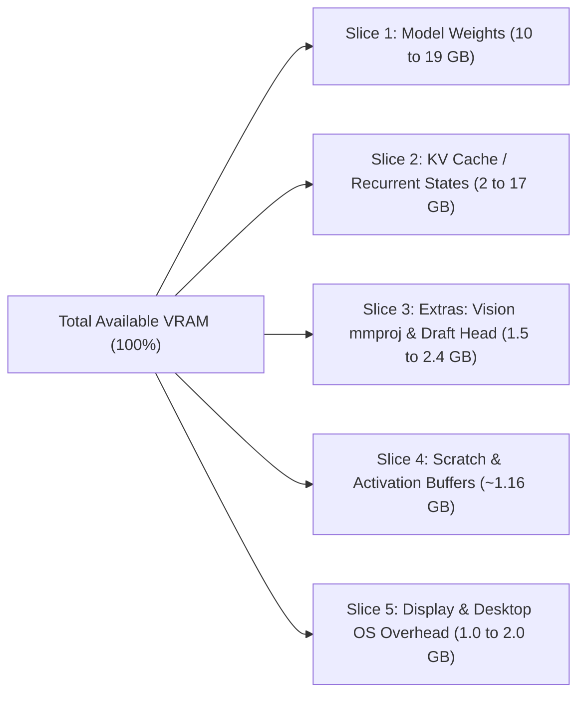

# Local AI Hardware, VRAM Allocation, and Model Setup Guide
**Authoritative Reference & Autonomous LLM Execution Runbook**
*Derived from Kernel Brief AI analysis of Qwen 3.8 27B and Qwen 3.8 Flash-Next (128GB VRAM vs. Expert Offloading)*

---

## Table of Contents
1. [Executive Summary & Quick Hardware Sizing Matrix](#1-executive-summary--quick-hardware-sizing-matrix)
2. [The 5 VRAM Slices & Theoretical Foundations](#2-the-5-vram-slices--theoretical-foundations)
   - [Slice 1: Model Weights & The Q4_K_M Trap](#slice-1-model-weights--the-q4_k_m-naming-trap)
   - [Slice 2: KV Cache & Gated Delta Linear Attention](#slice-2-kv-cache--gated-delta-linear-attention)
   - [Slice 3: Extras (Vision Projector & Speculative Draft Head)](#slice-3-extras-vision-adapter--speculative-draft-head)
   - [Slice 4: Scratch Space & State Buffers](#slice-4-scratch-space--state-buffers)
   - [Slice 5: Display Buffer & Host OS Overhead](#slice-5-display-buffer--host-os-overhead)
   - [The Memory Bandwidth Decoding Law](#the-memory-bandwidth-decoding-law)
3. [The 128GB VRAM Myth & "The Fourth Bit" Economics](#3-the-128gb-vram-myth--the-fourth-bit-economics)
   - [Qwen 3.8 Flash-Next Architecture & Expert Offloading](#qwen-38-flash-next-architecture--expert-offloading)
   - [The Hidden 96GB Memory Cap Trap](#the-hidden-96gb-memory-cap-trap)
   - [Engine Impact on Long-Context Prefill Speed](#engine-impact-on-long-context-prefill-speed)
   - [Economic Decision Matrix: Upgrades vs Unified Boxes vs Cloud](#economic-decision-matrix-upgrades-vs-unified-boxes-vs-cloud)
4. [Step-by-Step Hardware Setup Recipes](#4-step-by-step-hardware-setup-recipes)
   - [Recipe A: Qwen 3.8 Flash-Next via Strata (12GB–24GB GPU + System RAM)](#recipe-a-qwen-38-flash-next-via-strata-12gb24gb-gpu--system-ram)
   - [Recipe B: Qwen 3.8 27B on Consumer GPUs (8GB, 12GB, 16GB, 24GB, 32GB)](#recipe-b-qwen-38-27b-on-consumer-gpus-8gb-12gb-16gb-24gb-32gb)
   - [Recipe C: Unified Memory Workstations (Strix Halo, Mac Studio M5 Max, DGX Spark)](#recipe-c-unified-memory-workstations-strix-halo-mac-studio-m5-max-dgx-spark)
   - [Recipe D: Fixing Ollama (4K Context Window & Reasoning Traps)](#recipe-d-fixing-ollama-4k-context-window--reasoning-traps)
5. [Autonomous LLM & Agent Runbook (Claude Code / Codex / Antigravity CLI)](#5-autonomous-llm--agent-runbook-claude-code--codex--antigravity-cli)
   - [Master Prompt for Coding Agents](#master-prompt-for-coding-agents)
   - [Automated Hardware Diagnostics & Quant Picker (`detect_hardware.sh`)](#automated-hardware-diagnostics--quant-picker-detect_hardwaresh)
   - [Headless Screen Capture & Visual Verification Routine](#headless-screen-capture--visual-verification-routine)
   - [Automated Benchmark & Verification Harness (`benchmark_local_llm.py`)](#automated-benchmark--verification-harness-benchmark_local_llmpy)
6. [Repository Structure](#6-repository-structure)
7. [Appendix Links](#7-appendix-links)

---

## 1. Executive Summary & Quick Hardware Sizing Matrix

Deploying modern open weights (such as **Qwen 3.8 27B** and **Qwen 3.8 Flash-Next 125B MoE**) locally requires moving beyond simplistic VRAM sizing formulas. Memory allocation is split across five distinct hardware buffers, and token generation speed is strictly bounded by hardware memory bandwidth rather than compute FLOPS.

### At a Glance: Model Deployment Matrix

| Hardware Profile | Target Model & Quant | Engine / Tool | Context Window | KV Cache Precision | Expected Decode Speed | Role & Feasibility |
| :--- | :--- | :--- | :--- | :--- | :--- | :--- |
| **8 GB GPU**<br>*(e.g., RTX 3050, 4060 8GB)* | Qwen 3.8 27B `IQ2_XXS` (7.25 GB) | llama.cpp | 4k–8k tokens | 8-bit (`q8_0`) | 4–6 tok/s (CPU spilled)<br>~20–25 tok/s (pure GPU) | Barely viable; offloads layers to system RAM. Recommended to use 14B instead. |
| **12 GB GPU**<br>*(e.g., RTX 3060 12GB, RTX 4070)* | **Qwen 3.8 Flash-Next 3-bit** (Active 6B on GPU + 51B offloaded) | **Strata** | 32k tokens | FP16 / 8-bit | **50–62 tok/s**<br>(1,750 tok/s prefill) | **Sweet Spot for 12GB**: Far faster and smarter than 27B dense. |
| **12 GB GPU**<br>*(e.g., RTX 3060 12GB)* | Qwen 3.8 27B `IQ3_XXS` (~11 GB) | llama.cpp / Ollama | 8k–16k tokens | 8-bit (`q8_0`) | ~28–33 tok/s | Usable for medium context. Screen buffer must be minimized. |
| **16 GB GPU**<br>*(e.g., RTX 4060 Ti 16GB, 4080 16GB)* | Qwen 3.8 27B `IQ3_XXS` (11 GB) or `IQ4_XS` (14.25 GB) | llama.cpp / Ollama | 128k (`IQ3`)<br>20k (`IQ4`) | 4-bit (`q4_0`) or 8-bit (`q8_0`) | ~25–35 tok/s | Long-context coding assistant with `IQ3_XXS` + 4-bit KV. |
| **24 GB GPU**<br>*(e.g., RTX 3090, RTX 4090)* | **Qwen 3.8 27B `Q4_K_M`** (16.5–17.5 GB) + **Draft Head** | **llama.cpp** | 64k–128k tokens | 8-bit (`q8_0`) | **41.5 tok/s** (base)<br>**66 tok/s** (speculative) | **The Benchmark Gold Standard**: Full 4-bit accuracy, speculative boost. |
| **128 GB Unified Mini PC**<br>*(AMD Strix Halo Ryzen AI Max+ 395)* | Qwen 3.8 Flash-Next `Q4_K_M` (94–124 GB) | **Gufo / Strata** (Linux) | 128k+ tokens | 8-bit (`q8_0`) | 47–54 tok/s<br>(1,227–1,300 tok/s prefill) | Best value unified system ($3,099). **Must run Linux** to bypass 96GB cap. |
| **128 GB Mac Studio**<br>*(Apple M5 Max 40-core GPU)* | Qwen 3.8 Flash-Next / 27B FP16 | **MLX** (`mlx-serve`) | 128k–256k tokens | FP16 / 8-bit | 40 tok/s (prose)<br>75 tok/s (code) | Silent workstation, 614 GB/s bandwidth. **Requires sysctl memory unlock.** |
| **128 GB Unified CUDA**<br>*(Nvidia DGX Spark / Jetson Thor)* | Qwen 3.8 Flash-Next `NVFP4` | **vLLM** + SSD swap | 128k tokens | FP8 / 8-bit | ~41 tok/s decode<br>(1,666 tok/s prefill) | High prefill throughput for multi-turn agents. Uses fast NVMe SSD offload. |

---

## 2. The 5 VRAM Slices & Theoretical Foundations

When planning memory allocation for large language models, VRAM is divided into five distinct slices:



### Mathematical Model of Total VRAM Requirement
```text
VRAM_total = VRAM_weights + VRAM_KV + VRAM_extras + VRAM_scratch + VRAM_display
```

---

### Slice 1: Model Weights & The Q4_K_M Naming Trap
- **Unquantized Footprint:** Qwen 3.8 27B contains 27.8 billion parameters. At 16-bit precision (FP16/BF16, 2 bytes per param):
  `Size_FP16 = 27.8 * 2 = 55.6 GB`
- **Quantization Math:**
  `Size = (Parameters * Bits per Weight) / 8`
- **The "Q4_K_M" Recipe Discrepancy:**
  `Q4_K_M` is a quantization recipe that retains higher bit precision on critical layers, rather than a fixed file size:
  - **Unsloth `Q4_K_M`:** 16.5 GB (4.8 bits/weight)
  - **LM Studio `Q4_K_M`:** 16.8 GB (4.9 bits/weight)
  - **llama.cpp standard `Q4_K_M`:** 19.0 GB (5.6 bits/weight)
- **The Vocabulary Overhead:**
  Qwen 3.8 utilizes a massive 248,000-token tokenizer with 5,120 embedding dimensions. Because it maintains separate input embeddings and output projection matrices:
  `248,000 * 5,120 * 2 = 2.54 billion parameters`
  Over **9% of the entire model parameter count** resides entirely in the token vocabulary tables.
- **Accuracy Benchmarks across Quantizations:**
  - **4-bit (`Q4_K_M`, `IQ4_XS`):** Achieves **100% parity** with unquantized FP16 across 89 real-world terminal agent tasks.
  - **3-bit (`IQ3_XXS`, `Q3_K_M`):** Retains ~99.4% benchmark quality, requiring ~5-10% more reasoning tokens to reach identical conclusions.
  - **2-bit (`IQ2_XXS`, ~7.25 GB):** Noticeable degradation. Thinking models require ~25% more tokens, offsetting raw generation speed.
  - **1-bit (`IQ1_S`):** Scores worse than random guessing. Unusable.

---

### Slice 2: KV Cache & Gated Delta Linear Attention
In traditional Transformers (e.g. Llama 3), every attention layer stores Keys and Values for every single token in the context window. 

#### Qwen 3.8 Hybrid Architecture Breakthrough
Qwen 3.8 has 64 total layers, but only **16 layers** are standard multi-head self-attention. The remaining **48 layers** are **Gated Delta** linear attention layers.
1. **The 48 Gated Delta Layers:**
   - Maintain a running recurrent summary of approximately **3.27 MB per layer**.
   - Total memory: `48 * 3.27 MB = ~157 MB` **fixed**, regardless of context length (10 tokens or 250,000 tokens).
2. **The 16 Standard Attention Layers:**
   - Store Key and Value tensors for context retrieval.
   - 4 KV heads * 256 head dimension * 2 bytes (FP16) * 2 (K+V) * 16 layers = **64 KB per token**.
   - Context scaling table:
     - **32,000 tokens:** ~2.0 GB
     - **128,000 tokens:** ~8.5 GB
     - **262,144 tokens (full context):** ~17.0 GB

#### KV Cache Quantization Rules
- **8-bit KV (`-ctk q8_0 -ctv q8_0`):** Halves memory consumption (32k = 1.0 GB; 128k = 4.25 GB) with **near-zero loss in retrieval precision**. Recommended for all production setups.
- **4-bit KV (`-ctk q4_0 -ctv q4_0`):** Reduces memory to 25%, but benchmark data indicates severe degradation on long-document needle-in-a-haystack tasks. Only use for short tasks when constrained by 8GB/12GB hardware.

---

### Slice 3: Extras (Vision Adapter & Speculative Draft Head)
- **Vision Projector (`mmproj`):**
  - Enables vision-language input.
  - FP16 size: ~0.9 GB.
  - 8-bit quantized size: ~0.6 GB.
  - *Recommendation:* Do not load `mmproj` for pure coding/agent text workflows to save ~1 GB of VRAM.
- **Speculative Decoding Draft Head:**
  - A compact helper model (~1.5 GB) trained specifically to predict the next 2 tokens ahead of the main model.
  - Generates token candidates that the 27B model verifies in a single forward pass.
  - *Impact:* Jumps generation speed on an RTX 3090 from 41.5 tok/s to **66 tok/s** (+59% speedup).

---

### Slice 4: Scratch Space & State Buffers
- llama.cpp and inference engines allocate memory for intermediate activation tensors, attention logits, and CUDA kernel execution scratchpads.
- Standard allocation: **~1.0 GB**.
- Combined with the 157 MB Gated Delta recurrent state: **~1.16 GB**.

---

### Slice 5: Display Buffer & Host OS Overhead
- If your primary GPU is driving monitors, web browsers, and an X11/Wayland desktop compositor, VRAM is pre-allocated by the operating system:
  - 1080p Single Display: ~400–600 MB.
  - 4K Single Display: ~900 MB – 1.2 GB.
  - Multi-Monitor + Chrome/Electron: **1.5 GB – 2.2 GB**.
- *Crucial Rule:* On a 16GB GPU, you only have ~14.0 GB of usable VRAM for AI workloads unless running headless.

---

### The Memory Bandwidth Decoding Law

Unlike the prompt processing phase (prefill) which is compute/matrix-math bound, **token generation (decoding) is memory bandwidth bound**. To produce a single token, the GPU must stream every single weight from VRAM into its compute cores.

```text
Theoretical Decode Speed (tokens/sec) = (Memory Bandwidth (GB/s) / Model File Size (GB)) * Efficiency (0.75 - 0.80)
```

#### Bandwidth & Speed Comparison:
| GPU Hardware | Memory Bandwidth | Model File Size (Quant) | Theoretical Ceiling | Measured Real-World Speed |
| :--- | :--- | :--- | :--- | :--- |
| **RTX 3060 12GB** | 360 GB/s | 11.0 GB (`IQ3_XXS`) | 32.7 tok/s | ~28–31 tok/s |
| **RTX 4060 8GB** | 272 GB/s | 17.5 GB (`Q4_K_M` spilled to DDR4) | N/A (Spilled) | **4–6 tok/s** (DDR4 bottleneck) |
| **RTX 3090 24GB** | 936 GB/s | 17.5 GB (`Q4_K_M`) | 53.4 tok/s | **41.5 tok/s** (Base) / **66 tok/s** (Draft Head) |
| **RTX 4090 24GB** | 1,008 GB/s | 17.5 GB (`Q4_K_M`) | 57.6 tok/s | **46.0 tok/s** (Base) / **72 tok/s** (Draft Head) |
| **RTX 5090 32GB** | 1,792 GB/s | 22.0 GB (`Q6_K`) | 81.4 tok/s | ~65–75 tok/s |
| **Apple M4 Pro** | 273 GB/s | 11.0 GB (`IQ3_XXS`) | 24.8 tok/s | ~13–18 tok/s |
| **Apple M5 Max** | 614 GB/s | 17.5 GB (`Q4_K_M`) | 35.0 tok/s | ~30–35 tok/s (dense) / 75 tok/s (code MoE) |

> [!WARNING]
> **The System RAM Offloading Cliff**:
> DDR4 memory bandwidth is ~51 GB/s (dual-channel 3200MHz), and DDR5 is ~70–90 GB/s. As soon as a model exceeds GPU VRAM and spills layers into host system RAM, token generation speed collapses to **1.5 to 5 tokens/second**.

---

## 3. The 128GB VRAM Myth & "The Fourth Bit" Economics

### Qwen 3.8 Flash-Next Architecture & Expert Offloading
Qwen 3.8 Flash-Next is a 125B total parameter Mixture-of-Experts (MoE) model. However, it activates only **~6B parameters per token**, paired with a **51B parameter n-gram / sequence lookup table**.
- Because the 51B lookup table is queried sparsely, it does not need to live in high-speed GPU VRAM.
- **Strata** (and community engines like **Gufo**) partition the model:
  - **GPU VRAM:** Holds active transformer attention blocks (~6B params = ~6–10 GB).
  - **System Host RAM (over PCIe):** Holds the inactive expert weights and lookup tables.
- **Result on a 12GB GPU + 64GB DDR5 System:**
  - Token Decode Speed: **50 to 62 tokens/second**.
  - Prompt Prefill Speed: **1,750 tokens/second** (at 32k context).
  - Total Hardware Cost: A standard ~$800–$1,200 gaming PC.

### The Hidden 96GB Memory Cap Trap
Purchasing a "128GB" unified memory machine does not mean the operating system allows the GPU to use 128GB:
1. **AMD Strix Halo (Ryzen AI Max+ 395) on Windows:**
   Windows hard-caps the addressable VRAM allocation to **96 GB by default**, reserving 32 GB strictly for the CPU. A 124 GB 4-bit model will fail to load or crash. On **Linux**, kernel drivers allow allocating up to **110–120 GB**.
2. **Mac Studio M5 Max 128GB:**
   macOS enforces a default wired memory ceiling of **75% of physical RAM (~96 GB)** for the Metal GPU allocator. Loading a 94–105 GB model causes immediate kernel panics or Out-Of-Memory termination.
   *Fix:* Must manually raise the sysctl wired memory limit via terminal:
   ```bash
   sudo sysctl iogpu.wired_mem_limit_mb=114688
   ```
3. **Nvidia DGX Spark ($6,950, 128GB):**
   The operating system and CUDA runtime expose only ~122 GB of usable memory. Nvidia's official recipe keeps ~48 GB of model weights on an ultra-fast NVMe SSD and pages them during execution.

### Engine Impact on Long-Context Prefill Speed
Prefill speed (how fast an LLM processes a 30k–160k token agent prompt) depends heavily on engine implementation:
- **Default llama.cpp:** 113 tokens/second -> **23 minutes** to read a 160,000-token codebase prompt.
- **Gufo / Strata:** 1,227–1,300 tokens/second -> **~2 minutes** to read the identical prompt on the identical hardware.

### Economic Decision Matrix: Upgrades vs Unified Boxes vs Cloud
- **Upgrading an Existing PC:** Adding 64GB DDR5 RAM costs **~$80–$120**. This unlocks 3-bit Flash-Next at 50–62 tok/s.
- **The "Fourth Bit" Tax:**
  - Moving from 3-bit (fits in 12GB GPU + 64GB RAM) to full 4-bit (requires a 128GB unified pool) costs **$2,200** as an upgrade, or **$700** if building a brand-new system from scratch.
  - Since 3-bit retains 99.4% benchmark accuracy, buying a $3,000–$7,000 128GB box solely to gain 1 extra bit of precision is uneconomical for personal developer setups.
- **Cloud Economics:**
  At $0.47 per 1M output tokens (hosted API) or $2.29/hr for an RTX 6000 Ada (96GB VRAM) on RunPod, a $3,099 hardware purchase equals **6.6 billion tokens** or 1,480 hours of dedicated cloud compute.

---

## 4. Step-by-Step Hardware Setup Recipes

### Recipe A: Qwen 3.8 Flash-Next via Strata (12GB–24GB GPU + System RAM)
*Target: RTX 3060 12GB, RTX 4070 12GB, RTX 3090/4090 24GB + 64GB System DDR4/DDR5.*

Run the turnkey launch script in `configs/strata-12gb-setup.sh`:
```bash
./configs/strata-12gb-setup.sh
```

---

### Recipe B: Qwen 3.8 27B on Consumer GPUs (8GB, 12GB, 16GB, 24GB, 32GB)

#### B.1: 12GB GPU (e.g. RTX 3060 12GB / RTX 4070 12GB)
- **Model Quant:** `IQ3_XXS` (~11.0 GB file).
- **KV Cache:** 8-bit KV (`-ctk q8_0 -ctv q8_0`).
- **Context Limit:** 16,384 tokens.
```bash
llama-server     -m /models/qwen3.8-27b/qwen3.8-27b-iq3_xxs.gguf     -ngl 65     -c 16384     -ctk q8_0 -ctv q8_0     -fa     --host 0.0.0.0 --port 8080
```

#### B.2: 16GB GPU (e.g. RTX 4060 Ti 16GB / RTX 4080 16GB)
- **Model Quant:** `IQ3_XXS` for massive 128k context, OR `IQ4_XS` (14.25 GB) for 20k context.
```bash
llama-server     -m /models/qwen3.8-27b/qwen3.8-27b-iq3_xxs.gguf     -ngl 65     -c 131072     -ctk q4_0 -ctv q4_0     -fa     --host 0.0.0.0 --port 8080
```

#### B.3: 24GB GPU (RTX 3090 / RTX 4090 / LinuxDev Node) — The Performance Setup
- **Model Quant:** Full `Q4_K_M` (16.5–17.5 GB).
- **KV Cache:** 8-bit KV (up to 128k context).
- **Speculative Decoding:** Uses the official 1.5 GB Draft Head (`qwen3.8-27b-draft.gguf`) to reach **66–72 tok/s**.
Run the turnkey script in `configs/llama-server-24gb.sh`:
```bash
./configs/llama-server-24gb.sh
```

---

## 5. Autonomous LLM & Agent Runbook (Claude Code / Codex / Antigravity CLI)

### Master Prompt for Coding Agents

```text
<AGENT_INSTRUCTION>
You are tasked with deploying Qwen 3.8 (27B or Flash-Next) on this host machine.
Perform the following sequence autonomously:
1. Run `./scripts/detect_hardware.sh` to inspect total GPU VRAM, free VRAM, PCIe bus type, host RAM, and CPU cores.
2. Based on the JSON output of `detect_hardware.sh`:
   - If VRAM is 12GB: Select Qwen 3.8 Flash-Next 3-bit via Strata, OR Qwen 3.8 27B IQ3_XXS with 8-bit KV cache.
   - If VRAM is 16GB: Select Qwen 3.8 27B IQ3_XXS (for 128k context) or IQ4_XS (for 20k context).
   - If VRAM is 24GB: Select Qwen 3.8 27B Q4_K_M + Draft Head speculative decoding.
   - If Unified System (128GB): Verify OS limits (check `sysctl iogpu.wired_mem_limit_mb` on macOS, or `/sys/module/amdgpu/parameters/gttsize` on Linux).
3. Generate the launcher command line or Ollama Modelfile with `num_ctx` >= 65536.
4. Launch the model in the background and verify with `curl http://localhost:8080/health` or `ollama ps`.
5. Capture a screengrab or terminal snapshot to confirm VRAM usage and token generation rate using `./scripts/capture_terminal_state.sh`.
6. Run `python3 ./scripts/benchmark_local_llm.py` to confirm prompt prefill and generation speed.
</AGENT_INSTRUCTION>
```

---

## 6. Repository Structure

```text
code/qwen-setup/
├── README.md                                 # Master architectural guide & runbook
├── configs/
│   ├── Modelfile.qwen27b                    # Ollama Modelfile with 64k ctx & reasoning effort
│   ├── Modelfile.qwen27b-128k               # 128k context configuration
│   ├── llama-server-24gb.sh                 # 24GB GPU llama.cpp launcher with Draft Head
│   ├── strata-12gb-setup.sh                 # 12GB GPU Strata expert offload launcher
│   └── mac-m5-max-unlock.sh                 # Apple Silicon wired memory ceiling unlock
├── scripts/
│   ├── detect_hardware.sh                   # Auto-diagnostic hardware & quant picker
│   ├── capture_terminal_state.sh            # Visual screenshot & terminal state grabber
│   └── benchmark_local_llm.py               # Latency & throughput benchmark harness
└── transcripts/
    ├── 128gb-vram-local-ai-transcript.md    # Video 1 clean transcript
    ├── qwen-3.8-27b-vram-requirements-transcript.md # Video 2 clean transcript
    └── raw/                                 # Original .vtt and raw text files
```

---

## 7. Appendix Links

- [Video 1 Full Transcript: 128GB VRAM for Local AI](transcripts/128gb-vram-local-ai-transcript.md)
- [Video 2 Full Transcript: How Much VRAM Does Qwen 3.8 27B Really Need?](transcripts/qwen-3.8-27b-vram-requirements-transcript.md)
