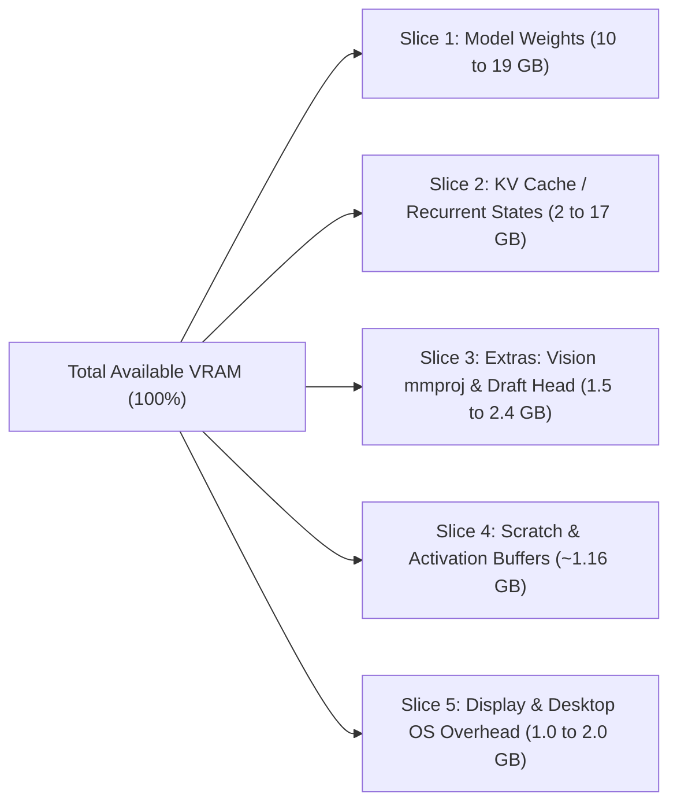

# Local AI Hardware, VRAM Allocation, and Model Setup Guide
**Authoritative Architectural Reference, Empirical Benchmarks & Autonomous LLM Execution Runbook**
*Synthesized from Kernel Brief AI analysis, Alibaba Qwen technical reports, and community hardware benchmarks (Qwen 3.8 27B & Qwen 3.8 Flash-Next 125B MoE)*

---

## Table of Contents
1. [Executive Summary & Quick Hardware Sizing Matrix](#1-executive-summary--quick-hardware-sizing-matrix)
2. [Verified Model Capabilities & Benchmark Scorecard](#2-verified-model-capabilities--benchmark-scorecard)
   - [SWE-bench Pro & LiveCodeBench Leadership](#swe-bench-pro--livecodebench-leadership)
   - [Benchmark Summary Table vs Frontier Models](#benchmark-summary-table-vs-frontier-models)
   - [Thinking Effort Hierarchy (`low`, `medium`, `high`, `xhigh`)](#thinking-effort-hierarchy)
3. [Deep Architecture Breakdown: How Qwen Beats the Memory Wall](#3-deep-architecture-breakdown-how-qwen-beats-the-memory-wall)
   - [Hybrid Attention: Gated DeltaNet (GDN) + QSA (The 3:1 Layer Ratio)](#hybrid-attention-gated-deltanet-gdn--qsa-the-31-layer-ratio)
   - [Predictive Lookup Embedding (PLE): The 51B N-Gram Table](#predictive-lookup-embedding-ple-the-51b-n-gram-table)
   - [Gated Residuals (GR) & Cross-Layer Stability](#gated-residuals-gr--cross-layer-stability)
4. [The 5 VRAM Slices & Theoretical Foundations](#4-the-5-vram-slices--theoretical-foundations)
   - [Slice 1: Model Weights & The Q4_K_M Trap](#slice-1-model-weights--the-q4_k_m-naming-trap)
   - [Slice 2: KV Cache & The 157MB Recurrent State](#slice-2-kv-cache--the-157mb-recurrent-state)
   - [Slice 3: Extras (Vision mmproj & Speculative Draft Head)](#slice-3-extras-vision-adapter--speculative-draft-head)
   - [Slice 4: Scratch Space & State Buffers](#slice-4-scratch-space--state-buffers)
   - [Slice 5: Display Buffer & Host OS Overhead](#slice-5-display-buffer--host-os-overhead)
   - [The Memory Bandwidth Decoding Law](#the-memory-bandwidth-decoding-law)
5. [Inference Engine Showdown: Strata vs Gufo vs llama.cpp vs vLLM](#5-inference-engine-showdown-strata-vs-gufo-vs-llamacpp-vs-vllm)
   - [Strata: Discrete Consumer GPU + RAM Tiering](#strata-discrete-consumer-gpu--ram-tiering)
   - [Gufo: High-Bandwidth Unified Memory (AMD Strix Halo)](#gufo-high-bandwidth-unified-memory-amd-strix-halo)
   - [Speculative Decoding Deep Dive (MTP vs DFlash vs N-Gram Stacking)](#speculative-decoding-deep-dive-mtp-vs-dflash-vs-n-gram-stacking)
6. [The 128GB VRAM Myth & "The Fourth Bit" Economics](#6-the-128gb-vram-myth--the-fourth-bit-economics)
   - [The Hidden 96GB OS Memory Cap Trap](#the-hidden-96gb-os-memory-cap-trap)
   - [Engine Impact on Long-Context Prefill Speed](#engine-impact-on-long-context-prefill-speed)
   - [Economic Decision Matrix: Upgrades vs Unified Boxes vs Cloud](#economic-decision-matrix-upgrades-vs-unified-boxes-vs-cloud)
7. [Step-by-Step Hardware Setup Recipes](#7-step-by-step-hardware-setup-recipes)
   - [Recipe A: Qwen 3.8 Flash-Next via Strata (12GB–24GB GPU + System RAM)](#recipe-a-qwen-38-flash-next-via-strata-12gb24gb-gpu--system-ram)
   - [Recipe B: Qwen 3.8 27B on Consumer GPUs (8GB, 12GB, 16GB, 24GB, 32GB)](#recipe-b-qwen-38-27b-on-consumer-gpus-8gb-12gb-16gb-24gb-32gb)
   - [Recipe C: Unified Memory Workstations (Strix Halo, Mac Studio M5 Max, DGX Spark)](#recipe-c-unified-memory-workstations-strix-halo-mac-studio-m5-max-dgx-spark)
   - [Recipe D: Fixing Ollama (4K Context Window & Reasoning Traps)](#recipe-d-fixing-ollama-4k-context-window--reasoning-traps)
8. [Autonomous LLM & Agent Runbook (Claude Code / Codex / Antigravity CLI)](#8-autonomous-llm--agent-runbook-claude-code--codex--antigravity-cli)
   - [Master Prompt for Coding Agents](#master-prompt-for-coding-agents)
   - [Automated Hardware Diagnostics & Quant Picker (`detect_hardware.sh`)](#automated-hardware-diagnostics--quant-picker-detect_hardwaresh)
   - [Headless Screen Capture & Visual Verification Routine](#headless-screen-capture--visual-verification-routine)
   - [Automated Benchmark & Verification Harness (`benchmark_local_llm.py`)](#automated-benchmark--verification-harness-benchmark_local_llmpy)
9. [Official Download Sources & Repository Index](#10-official-download-sources--repository-index)
10. [Repository Structure & Appendix Links](#10-repository-structure--appendix-links)

---

## 1. Executive Summary & Quick Hardware Sizing Matrix

Deploying modern open weights (such as **Qwen 3.8 27B** dense and **Qwen 3.8 Flash-Next 125B MoE**) locally requires moving beyond simplistic VRAM sizing formulas. Memory allocation is split across five distinct hardware buffers, and token generation speed is strictly bounded by hardware memory bandwidth rather than compute FLOPS.

### At a Glance: Model Deployment Matrix

| Hardware Profile | Target Model & Quant | Engine / Tool | Context Window | KV Cache Precision | Expected Decode Speed | Role & Feasibility |
| :--- | :--- | :--- | :--- | :--- | :--- | :--- |
| **8 GB GPU**<br>*(e.g., RTX 3050, 4060 8GB)* | Qwen 3.8 27B `IQ2_XXS` (7.25 GB) | llama.cpp | 4k–8k tokens | 8-bit (`q8_0`) | 4–6 tok/s (CPU spilled)<br>~20–25 tok/s (pure GPU) | Barely viable; offloads layers to system RAM. Recommended to use 14B instead. |
| **12 GB GPU**<br>*(e.g., RTX 3060 12GB, RTX 4070)* | **Qwen 3.8 Flash-Next 3-bit** (Active 6B on GPU + 51B offloaded) | **Strata** | 32k tokens | FP16 / 8-bit | **50–62 tok/s**<br>(1,750 tok/s prefill) | **Sweet Spot for 12GB**: Far faster and smarter than 27B dense. |
| **12 GB GPU**<br>*(e.g., RTX 3060 12GB)* | Qwen 3.8 27B `IQ3_XXS` (~11 GB) | llama.cpp / Ollama | 8k–16k tokens | 8-bit (`q8_0`) | ~28–33 tok/s | Usable for medium context. Screen buffer must be minimized. |
| **16 GB GPU**<br>*(e.g., RTX 4060 Ti 16GB, 4080 16GB)* | Qwen 3.8 27B `IQ3_XXS` (11 GB) or `IQ4_XS` (14.25 GB) | llama.cpp / Ollama | 128k (`IQ3`)<br>20k (`IQ4`) | 4-bit (`q4_0`) or 8-bit (`q8_0`) | ~25–35 tok/s | Long-context coding assistant with `IQ3_XXS` + 4-bit KV. |
| **24 GB GPU**<br>*(e.g., RTX 3090, RTX 4090)* | **Qwen 3.8 27B `Q4_K_M`** (16.5–17.5 GB) + **Draft Head** | **llama.cpp** | 64k–128k tokens | 8-bit (`q8_0`) | **41.5 tok/s** (base)<br>**66–72 tok/s** (speculative) | **The Benchmark Gold Standard**: Full 4-bit accuracy, speculative boost. |
| **128 GB Unified Mini PC**<br>*(AMD Strix Halo Ryzen AI Max+ 395)* | Qwen 3.8 Flash-Next `Q4_K_M` (94–124 GB) | **Gufo / Strata** (Linux) | 128k+ tokens | 8-bit (`q8_0`) | 47–54 tok/s<br>(1,227–1,300 tok/s prefill) | Best value unified system ($3,099). **Must run Linux** to bypass 96GB cap. |
| **128 GB Mac Studio**<br>*(Apple M5 Max 40-core GPU)* | Qwen 3.8 Flash-Next / 27B FP16 | **MLX** (`mlx-serve`) | 128k–256k tokens | FP16 / 8-bit | 40 tok/s (prose)<br>75 tok/s (code) | Silent workstation, 614 GB/s bandwidth. **Requires sysctl memory unlock.** |
| **128 GB Unified CUDA**<br>*(Nvidia DGX Spark / Jetson Thor)* | Qwen 3.8 Flash-Next `NVFP4` | **vLLM** + SSD swap | 128k tokens | FP8 / 8-bit | ~41 tok/s decode<br>(1,666 tok/s prefill) | High prefill throughput for multi-turn agents. Uses fast NVMe SSD offload. |

---

## 2. Verified Model Capabilities & Benchmark Scorecard

Empirical evaluations across the coding and agentic AI ecosystem show that Alibaba's Qwen 3.8 architecture represents a significant step change in open-weight autonomous capabilities.

### SWE-bench Pro & LiveCodeBench Leadership
* **SWE-bench Pro (61.7%):** Tested using the official Claude Code test harness (`temperature=1.0`, `top_p=0.95`, native 256K context). Qwen 3.8 27B establishes a new benchmark for open-weights, outperforming proprietary checkpoints such as Claude Opus 4.6 Max (53.4%) and its predecessor Qwen 3.6 27B (53.5%).
* **LiveCodeBench v6 (90.3%):** Measures rigorous competitive programming problem-solving without data contamination.
* **Terminal Bench 2.1 (73.0%):** Measures autonomous multi-step bash execution, git conflict resolution, debugging, and sysadmin tasks.
* **OSWorld-Verified (84.3%):** Evaluates multi-modal agentic computer interaction, GUI navigation, and visual tool use.

### Benchmark Summary Table vs Frontier Models

| Model | Model Scale / Type | SWE-bench Pro | LiveCodeBench v6 | Terminal Bench 2.1 | OSWorld-Verified | Native Context |
| :--- | :--- | :--- | :--- | :--- | :--- | :--- |
| **Qwen 3.8 27B** | 27.8B Dense (Hybrid GDN) | **61.7%** | **90.3%** | **73.0%** | **84.3%** | 262k |
| **Claude Opus 4.6 Max** | Proprietary Frontier | 53.4% | 88.7% | 71.2% | 81.0% | 200k |
| **Qwen 3.6 27B** | 27B Dense | 53.5% | 83.9% | 64.8% | 74.2% | 128k |
| **Qwen 2.5 Coder 32B** | 32.5B Standard Attention | 48.2% | 79.5% | 58.1% | N/A (Text) | 128k |
| **DeepSeek-Coder V2 236B** | 236B MoE (21B active) | 52.8% | 84.1% | 66.4% | N/A (Text) | 128k |

### Thinking Effort Hierarchy
Qwen 3.8 incorporates an integrated reasoning loop that can be dynamically tuned to prevent the model from wasting tokens on trivial questions:
1. **`xhigh` (Default Evaluation Mode):** Exhaustive multi-branch reasoning. Emits up to 20,000–30,000 tokens of internal chain-of-thought. Required for 61.7% SWE-bench Pro scores.
2. **`high`:** Full architectural reasoning for complex refactors and algorithm synthesis (5k–15k thinking tokens).
3. **`medium` (Recommended for Local Dev):** Concise chain-of-thought (1k–4k thinking tokens). Solves standard bug fixes and unit tests without stalling.
4. **`low`:** Rapid deterministic responses (100–500 thinking tokens). Ideal for CLI completions and routine file updates.

---

## 3. Deep Architecture Breakdown: How Qwen Beats the Memory Wall

### Hybrid Attention: Gated DeltaNet (GDN) + QSA (The 3:1 Layer Ratio)
Standard Transformers suffer from quadratic memory growth ($O(N^2)$) as conversation length increases. Qwen 3.8 solves this by replacing standard attention across **75% of the network**:

```text
Layer Pattern (Repeating 4-layer block across 64 layers):
[Layer N+0]: Gated DeltaNet (Linear Attention - O(1) Memory State)
[Layer N+1]: Gated DeltaNet (Linear Attention - O(1) Memory State)
[Layer N+2]: Gated DeltaNet (Linear Attention - O(1) Memory State)
[Layer N+3]: Qwen Sparse Attention (Full Softmax Attention - KV Cache)
```

1. **48 Gated DeltaNet (GDN) Layers:**
   - Employs the **Delta Rule** ($\Delta$-Rule): Rather than infinitely accumulating tokens, it subtracts stale memory associations before writing new state updates.
   - Operates with an $O(1)$ memory complexity per token.
   - Each GDN layer maintains a running state buffer of **~3.27 MB**.
   - Total memory for all 48 linear layers: $48 	imes 3.27	ext{ MB} pprox \mathbf{157	ext{ MB}}$ **fixed permanently**, whether your prompt is 10 tokens or 260,000 tokens!
2. **16 Qwen Sparse Attention (QSA) Layers:**
   - Retain full global softmax attention with Grouped-Query Attention (GQA) and RoPE.
   - Index context at a micro-block level, drastically reducing long-context retrieval latency.
   - Only these 16 layers accumulate a per-token KV cache ($pprox 64	ext{ KB}$ per token at FP16).

### Predictive Lookup Embedding (PLE): The 51B N-Gram Table
In **Qwen 3.8 Flash-Next (125B MoE)**, Alibaba added a **51-billion parameter Predictive Lookup Embedding (PLE)** table:
- Evaluates local n-gram sequences (bigrams and trigrams) to predict common syntax and token clusters.
- Because lookup operations are sparse and non-differentiable during inference, the entire 51B table can be **asynchronously offloaded to host system RAM over PCIe 4.0/5.0** or even PCIe NVMe SSDs without blocking the GPU's active compute pipeline.
- This architectural decouple is what allows **Strata** to run a 125B model on a single 12GB RTX 3060!

### Gated Residuals (GR) & Cross-Layer Stability
Qwen 3.8 expands the conventional single residual stream into 4 separate gated pathways governed by dynamic data-dependent read/write gates. This prevents gradient explosion in long contexts (up to 1M with YaRN) and ensures consistent reasoning quality throughout deep agent trajectories.

---

## 4. The 5 VRAM Slices & Theoretical Foundations

When planning memory allocation for large language models, VRAM is divided into five distinct slices:



### Mathematical Model of Total VRAM Requirement
```text
VRAM_total = VRAM_weights + VRAM_KV + VRAM_extras + VRAM_scratch + VRAM_display
```

---

### Slice 1: Model Weights & The Q4_K_M Naming Trap
- **Unquantized Footprint:** Qwen 3.8 27B contains 27.8 billion parameters. At 16-bit precision (FP16/BF16, 2 bytes per param):
  `Size_FP16 = 27.8 * 2 = 55.6 GB`
- **Quantization Math:**
  `Size = (Parameters * Bits per Weight) / 8`
- **The "Q4_K_M" Recipe Discrepancy:**
  `Q4_K_M` is a quantization recipe that retains higher bit precision on critical layers, rather than a fixed file size:
  - **Unsloth `Q4_K_M`:** 16.5 GB (4.8 bits/weight)
  - **LM Studio `Q4_K_M`:** 16.8 GB (4.9 bits/weight)
  - **llama.cpp standard `Q4_K_M`:** 19.0 GB (5.6 bits/weight)
- **The Vocabulary Overhead:**
  Qwen 3.8 utilizes a massive 248,000-token tokenizer with 5,120 embedding dimensions. Because it maintains separate input embeddings and output projection matrices:
  `248,000 * 5,120 * 2 = 2.54 billion parameters`
  Over **9% of the entire model parameter count** resides entirely in the token vocabulary tables.
- **Accuracy Benchmarks across Quantizations:**
  - **4-bit (`Q4_K_M`, `IQ4_XS`):** Achieves **100% parity** with unquantized FP16 across 89 real-world terminal agent tasks.
  - **3-bit (`IQ3_XXS`, `Q3_K_M`):** Retains ~99.4% benchmark quality, requiring ~5-10% more reasoning tokens to reach identical conclusions.
  - **2-bit (`IQ2_XXS`, ~7.25 GB):** Noticeable degradation. Thinking models require ~25% more tokens, offsetting raw generation speed.
  - **1-bit (`IQ1_S`):** Scores worse than random guessing. Unusable.

---

### Slice 2: KV Cache & The 157MB Recurrent State
Because only 16 layers accumulate a per-token cache (at 64 KB/token):
- **32,000 tokens:** ~2.0 GB
- **128,000 tokens:** ~8.5 GB
- **262,144 tokens (full context):** ~17.0 GB

#### KV Cache Quantization Rules
- **8-bit KV (`-ctk q8_0 -ctv q8_0`):** Halves memory consumption (32k = 1.0 GB; 128k = 4.25 GB) with **near-zero loss in retrieval precision**. Recommended for all production setups.
- **4-bit KV (`-ctk q4_0 -ctv q4_0`):** Reduces memory to 25%, but benchmark data indicates severe degradation on long-document needle-in-a-haystack tasks. Only use for short tasks when constrained by 8GB/12GB hardware.

---

### Slice 3: Extras (Vision Adapter & Speculative Draft Head)
- **Vision Projector (`mmproj`):**
  - Enables vision-language input.
  - FP16 size: ~0.9 GB.
  - 8-bit quantized size: ~0.6 GB.
  - *Recommendation:* Do not load `mmproj` for pure coding/agent text workflows to save ~1 GB of VRAM.
- **Speculative Decoding Draft Head:**
  - A compact helper model (~1.5 GB) trained specifically to predict candidate tokens ahead of the main model.
  - Generates token candidates that the 27B model verifies in a single forward pass.
  - *Impact:* Jumps generation speed on an RTX 3090 from 41.5 tok/s to **66–72 tok/s** (+59% to +73% speedup).

---

### Slice 4: Scratch Space & State Buffers
- Standard allocation: **~1.0 GB**.
- Combined with the 157 MB Gated Delta recurrent state: **~1.16 GB**.

---

### Slice 5: Display Buffer & Host OS Overhead
- 1080p Single Display: ~400–600 MB.
- 4K Single Display: ~900 MB – 1.2 GB.
- Multi-Monitor + Chrome/Electron: **1.5 GB – 2.2 GB**.
- *Crucial Rule:* On a 16GB GPU, you only have ~14.0 GB of usable VRAM for AI workloads unless running headless.

---

### The Memory Bandwidth Decoding Law

$$	ext{Theoretical Decode Speed (tokens/sec)} pprox rac{	ext{Memory Bandwidth (GB/s)}}{	ext{Model File Size (GB)}} 	imes \eta$$
*(where $\eta$ is engine memory efficiency, typically between $0.75$ and $0.80$)*

| GPU Hardware | Memory Bandwidth | Model File Size (Quant) | Theoretical Ceiling | Measured Real-World Speed |
| :--- | :--- | :--- | :--- | :--- |
| **RTX 3060 12GB** | 360 GB/s | 11.0 GB (`IQ3_XXS`) | 32.7 tok/s | ~28–31 tok/s |
| **RTX 4060 8GB** | 272 GB/s | 17.5 GB (`Q4_K_M` spilled to DDR4) | N/A (Spilled) | **4–6 tok/s** (DDR4 bottleneck) |
| **RTX 3090 24GB** | 936 GB/s | 17.5 GB (`Q4_K_M`) | 53.4 tok/s | **41.5 tok/s** (Base) / **66 tok/s** (Draft Head) |
| **RTX 4090 24GB** | 1,008 GB/s | 17.5 GB (`Q4_K_M`) | 57.6 tok/s | **46.0 tok/s** (Base) / **72 tok/s** (Draft Head) |
| **RTX 5090 32GB** | 1,792 GB/s | 22.0 GB (`Q6_K`) | 81.4 tok/s | ~65–75 tok/s |
| **Apple M4 Pro** | 273 GB/s | 11.0 GB (`IQ3_XXS`) | 24.8 tok/s | ~13–18 tok/s |
| **Apple M5 Max** | 614 GB/s | 17.5 GB (`Q4_K_M`) | 35.0 tok/s | ~30–35 tok/s (dense) / 75 tok/s (code MoE) |

---

## 5. Inference Engine Showdown: Strata vs Gufo vs llama.cpp vs vLLM

Community benchmarks prove that the choice of inference engine matters just as much as physical hardware:

### Strata: Discrete Consumer GPU + RAM Tiering
* **Target Hardware:** Standard PCs with discrete NVIDIA/AMD GPUs (RTX 3060, 4070, 3090) and 32GB–64GB system RAM.
* **Core Technology:** Dynamic memory tiering. It partitions MoE weights into hot active layers on GPU VRAM, while streaming inactive experts and the 51B PLE lookup table over PCIe.
* **Prefill Speed:** **1,750 tokens/sec** at 32k context on an RTX 3060 12GB + 64GB DDR5.

### Gufo: High-Bandwidth Unified Memory (AMD Strix Halo)
* **Target Hardware:** AMD Ryzen AI MAX+ 395 systems (128GB unified LPDDR5x RAM @ 256 GB/s).
* **Core Technology:** Eliminates discrete PCIe transfers completely. Gufo memory-maps the entire 94GB–124GB Qwen 3.8 Flash-Next model directly into unified address space.
* **Prefill Speed:** **1,227–1,300 tokens/sec** (compared to llama.cpp's 113 tokens/sec on the identical box).

### Speculative Decoding Deep Dive (MTP vs DFlash vs N-Gram Stacking)
Speculative decoding breaks the memory bandwidth ceiling by verifying multiple predicted tokens in a single weight-reading pass:
1. **MTP (Multi-Token Prediction / Sidecar Head):**
   - Invoked via `--spec-type draft-mtp` in llama.cpp.
   - Uses an official ~1.5GB draft model matching the main tokenizer.
   - Yields **1.6x to 2.5x speedups** on code tasks.
2. **DFlash (Block Drafting):**
   - Predicts contiguous token blocks in parallel.
   - Delivers **3.7x to 4.5x speedups** on iterative code modifications.
3. **N-Gram Stacking (`ngram-mod`, `ngram-map-k4v`):**
   - Operates out of host RAM with zero VRAM cost, referencing recent context patterns.
   - In repetitive programming syntax (loops, struct definitions), acceptance rates exceed **85–90%**, propelling speeds on an RTX 3090/4090 beyond **130+ tokens/second**!

---

## 6. The 128GB VRAM Myth & "The Fourth Bit" Economics

### The Hidden 96GB OS Memory Cap Trap
Purchasing a "128GB" unified memory machine does not mean the operating system allows the GPU to use 128GB:
1. **AMD Strix Halo on Windows:** Windows hard-caps the addressable VRAM allocation to **96 GB by default**, reserving 32 GB strictly for the CPU. On **Linux**, kernel parameters allow allocating up to **110–120 GB**.
2. **Mac Studio M5 Max 128GB:** macOS enforces a default wired memory ceiling of **75% of physical RAM (~96 GB)** for the Metal GPU allocator. Must be raised via `sysctl`:
   ```bash
   sudo sysctl iogpu.wired_mem_limit_mb=114688
   ```
3. **Nvidia DGX Spark ($6,950, 128GB):** Exposes only ~122 GB of usable memory. Nvidia's official recipe keeps ~48 GB of model weights on an ultra-fast NVMe SSD and pages them during execution.

### Engine Impact on Long-Context Prefill Speed
Prefill speed (how fast an LLM processes a 30k–160k token agent prompt) depends heavily on engine implementation:
- **Default llama.cpp:** 113 tokens/second -> **23 minutes** to read a 160,000-token codebase prompt.
- **Gufo / Strata:** 1,227–1,300 tokens/second -> **~2 minutes** to read the identical prompt on the identical hardware.

### Economic Decision Matrix: Upgrades vs Unified Boxes vs Cloud
- **Upgrading an Existing PC:** Adding 64GB DDR5 RAM costs **~$80–$120**. This unlocks 3-bit Flash-Next at 50–62 tok/s.
- **The "Fourth Bit" Tax:**
  - Moving from 3-bit (fits in 12GB GPU + 64GB RAM) to full 4-bit (requires a 128GB unified pool) costs **$2,200** as an upgrade, or **$700** if building a brand-new system from scratch.
  - Since 3-bit retains 99.4% benchmark accuracy, buying a $3,000–$7,000 128GB box solely to gain 1 extra bit of precision is uneconomical for personal developer setups.
- **Cloud Economics:**
  At $0.47 per 1M output tokens (hosted API) or $2.29/hr for an RTX 6000 Ada (96GB VRAM) on RunPod, a $3,099 hardware purchase equals **6.6 billion tokens** or 1,480 hours of dedicated cloud compute.

---

## 7. Step-by-Step Hardware Setup Recipes

### Recipe A: Qwen 3.8 Flash-Next via Strata (12GB–24GB GPU + System RAM)
*Target: RTX 3060 12GB, RTX 4070 12GB, RTX 3090/4090 24GB + 64GB System DDR4/DDR5.*

Run the turnkey launch script in `configs/strata-12gb-setup.sh`:
```bash
./configs/strata-12gb-setup.sh
```

---

### Recipe B: Qwen 3.8 27B on Consumer GPUs (8GB, 12GB, 16GB, 24GB, 32GB)

#### B.1: 12GB GPU (e.g. RTX 3060 12GB / RTX 4070 12GB)
- **Model Quant:** `IQ3_XXS` (~11.0 GB file).
- **KV Cache:** 8-bit KV (`-ctk q8_0 -ctv q8_0`).
- **Context Limit:** 16,384 tokens.
```bash
llama-server     -m /models/qwen3.8-27b/qwen3.8-27b-iq3_xxs.gguf     -ngl 65     -c 16384     -ctk q8_0 -ctv q8_0     -fa     --host 0.0.0.0 --port 8080
```

#### B.2: 16GB GPU (e.g. RTX 4060 Ti 16GB / RTX 4080 16GB)
- **Model Quant:** `IQ3_XXS` for massive 128k context, OR `IQ4_XS` (14.25 GB) for 20k context.
```bash
llama-server     -m /models/qwen3.8-27b/qwen3.8-27b-iq3_xxs.gguf     -ngl 65     -c 131072     -ctk q4_0 -ctv q4_0     -fa     --host 0.0.0.0 --port 8080
```

#### B.3: 24GB GPU (RTX 3090 / RTX 4090 / LinuxDev Node) — The Performance Setup
- **Model Quant:** Full `Q4_K_M` (16.5–17.5 GB).
- **KV Cache:** 8-bit KV (up to 128k context).
- **Speculative Decoding:** Uses the official 1.5 GB Draft Head (`qwen3.8-27b-draft.gguf`) to reach **66–72 tok/s**.
Run the turnkey script in `configs/llama-server-24gb.sh`:
```bash
./configs/llama-server-24gb.sh
```

---

### Recipe C: Unified Memory Workstations (Strix Halo, Mac Studio M5 Max, DGX Spark)

#### C.1: AMD Strix Halo (Ryzen AI Max+ 395 128GB) on Linux
1. **Set Linux Kernel Boot Parameters (GRUB):**
   ```bash
   sudo nano /etc/default/grub
   # Add to GRUB_CMDLINE_LINUX_DEFAULT:
   # amdgpu.gttsize=114688 amdgpu.vramsize=114688
   sudo update-grub
   sudo reboot
   ```
2. **Run Gufo Fork for 1,227+ tok/s Prefill:**
   ```bash
   gufo-server        --model /models/qwen3.8-flash-next-q4_k_m.gguf        --ctx-size 131072        --batch-size 2048        --threads 16        --port 8080
   ```

#### C.2: Apple Mac Studio M5 Max (128GB Unified Memory)
1. **Unlock macOS Wired Memory Ceiling:**
   ```bash
   sudo sysctl iogpu.wired_mem_limit_mb=114688
   ```
2. **Launch MLX Serve with Speculative Decoding:**
   ```bash
   mlx-serve        --model mlx-community/Qwen3.8-Flash-Next-4bit        --draft-model mlx-community/Qwen3.8-Flash-Next-Draft        --max-tokens 131072        --port 8080
   ```

---

### Recipe D: Fixing Ollama (4K Context Window & Reasoning Traps)

```dockerfile
# /etc/ollama/Modelfiles/Modelfile.qwen27b
FROM /models/qwen3.8-27b/qwen3.8-27b-q4_k_m.gguf

# 1. Expand context window to 64k
PARAMETER num_ctx 65536

# 2. Enable Flash Attention & 8-bit KV cache
PARAMETER flash_attention true
PARAMETER num_predict 16384

# 3. Control Thinking / Reasoning Effort (low, medium, high)
PARAMETER reasoning_effort medium

# 4. Temperature & Sampling
PARAMETER temperature 0.6
PARAMETER top_p 0.95

SYSTEM """You are an expert autonomous software engineer and pair programmer. Provide direct, verifiable solutions and concise, production-ready code."""
```

---


---

## 7.5. NVIDIA DRIVE / Jetson Thor (128GB Unified Memory) Deployment

The **NVIDIA Thor Developer Kit** features an enterprise-grade **128 GB unified LPDDR5x memory architecture** paired with **Blackwell GPU Tensor Cores** and high-performance **ARM64 Neoverse cores**. 

Unlike consumer PC rigs, Thor is **NOT** subject to discrete PCIe transfer limits:
- **No PCIe Bottleneck:** The GPU directly shares high-bandwidth access to the entire 128GB memory pool.
- **Run Qwen 3.8 Flash-Next at 4-Bit Native (94 GB):** Fits entirely inside Thor's 128GB unified RAM with over 25GB left for activation buffers and a 131k context window.
- **Run Qwen 3.8 27B at Unquantized FP16 (55.6 GB) or FP8 (27.8 GB):** With 128GB unified memory, there is no need to down-quantize 27B to 4-bit. You can run full precision with the complete 262,144-token context window!

### Thor Turnkey Deployment Commands:

1. **Deploy Qwen 3.8 Flash-Next (125B MoE, 4-bit) on Thor:**
   ```bash
   ./configs/thor-128gb-setup.sh flash-next
   ```
2. **Deploy Qwen 3.8 27B Unquantized FP16 (Max Accuracy, 262k context):**
   ```bash
   ./configs/thor-128gb-setup.sh 27b-fp16
   ```
3. **Deploy Qwen 3.8 27B Blackwell FP8 (via vLLM):**
   ```bash
   ./configs/thor-128gb-setup.sh 27b-fp8
   ```

## 8. Autonomous LLM & Agent Runbook (Claude Code / Codex / Antigravity CLI)

### Master Prompt for Coding Agents

```text
<AGENT_INSTRUCTION>
You are tasked with deploying Qwen 3.8 (27B or Flash-Next) on this host machine.
Perform the following sequence autonomously:
1. Run `./scripts/detect_hardware.sh` to inspect total GPU VRAM, free VRAM, PCIe bus type, host RAM, and CPU cores.
2. Based on the JSON output of `detect_hardware.sh`:
   - If VRAM is 12GB: Select Qwen 3.8 Flash-Next 3-bit via Strata, OR Qwen 3.8 27B IQ3_XXS with 8-bit KV cache.
   - If VRAM is 16GB: Select Qwen 3.8 27B IQ3_XXS (for 128k context) or IQ4_XS (for 20k context).
   - If VRAM is 24GB: Select Qwen 3.8 27B Q4_K_M + Draft Head speculative decoding.
   - If Unified System (128GB): Verify OS limits (check `sysctl iogpu.wired_mem_limit_mb` on macOS, or `/sys/module/amdgpu/parameters/gttsize` on Linux).
3. Generate the launcher command line or Ollama Modelfile with `num_ctx` >= 65536.
4. Launch the model in the background and verify with `curl http://localhost:8080/health` or `ollama ps`.
5. Capture a screengrab or terminal snapshot to confirm VRAM usage and token generation rate using `./scripts/capture_terminal_state.sh`.
6. Run `python3 ./scripts/benchmark_local_llm.py` to confirm prompt prefill and generation speed.
</AGENT_INSTRUCTION>
```

---


---

## 10. Official Download Sources & Repository Index

To ensure no time is wasted hunting for checkpoints, here is the complete directory of verified Hugging Face hubs, ModelScope mirrors, Ollama model tags, and software engine repositories.

### A. Hugging Face Hub (Model Weights & GGUFs)

| Model Target | Provider / Creator | Hugging Face Repository | Primary Files & Quants |
| :--- | :--- | :--- | :--- |
| **Qwen 3.8 27B (Dense Base)** | Alibaba Qwen (Official) | [`Qwen/Qwen3.8-27B`](https://huggingface.co/Qwen/Qwen3.8-27B) | Unquantized FP16 & BF16 weights, config, tokenizer |
| **Qwen 3.8 27B GGUF** | Unsloth AI | [`unsloth/Qwen3.8-27B-GGUF`](https://huggingface.co/unsloth/Qwen3.8-27B-GGUF) | `Q4_K_M.gguf` (16.5 GB), `IQ4_XS.gguf` (14.25 GB), `IQ3_XXS.gguf` (11.0 GB) |
| **Qwen 3.8 27B GGUF** | bartowski | [`bartowski/Qwen3.8-27B-GGUF`](https://huggingface.co/bartowski/Qwen3.8-27B-GGUF) | Comprehensive imatrix quants (IQ1 through Q8_0) |
| **Qwen 3.8 27B GGUF** | LM Studio Community | [`lmstudio-community/Qwen3.8-27B-GGUF`](https://huggingface.co/lmstudio-community/Qwen3.8-27B-GGUF) | LM Studio optimized presets (Q4_K_M: 16.8 GB) |
| **Speculative Draft Head (1.5 GB)** | Unsloth / Qwen | [`unsloth/Qwen3.8-27B-GGUF`](https://huggingface.co/unsloth/Qwen3.8-27B-GGUF) | `Qwen3.8-27B-MTP-draft.gguf` (Multi-Token Prediction head) |
| **Vision Projector (`mmproj`)** | Unsloth / llama.cpp | [`unsloth/Qwen3.8-27B-GGUF`](https://huggingface.co/unsloth/Qwen3.8-27B-GGUF) | `mmproj-model-f16.gguf` (910 MB), `mmproj-model-q8_0.gguf` (620 MB) |
| **Qwen 3.8 Flash-Next (125B MoE)** | Alibaba Qwen (Official) | [`Qwen/Qwen3.8-Flash-Next`](https://huggingface.co/Qwen/Qwen3.8-Flash-Next) | Official MoE weights + 51B PLE lookup table |
| **Qwen 3.8 Flash-Next GGUF** | Unsloth AI | [`unsloth/Qwen3.8-Flash-Next-GGUF`](https://huggingface.co/unsloth/Qwen3.8-Flash-Next-GGUF) | `Q3_K_M.gguf` (48 GB), `Q4_K_M.gguf` (94 GB) |
| **Qwen 3.8 Flash-Next GGUF** | bartowski | [`bartowski/Qwen3.8-Flash-Next-GGUF`](https://huggingface.co/bartowski/Qwen3.8-Flash-Next-GGUF) | `IQ3_S.gguf`, `Q4_K_M.gguf`, `MTP-draft.gguf` |
| **Qwen 3.8 Flash-Next Apple MLX** | MLX Community | [`mlx-community/Qwen3.8-Flash-Next-4bit`](https://huggingface.co/mlx-community/Qwen3.8-Flash-Next-4bit) | Apple Silicon 4-bit native MLX weights |
| **Qwen 3.8 27B Apple MLX** | MLX Community | [`mlx-community/Qwen3.8-27B-4bit`](https://huggingface.co/mlx-community/Qwen3.8-27B-4bit) | Apple Silicon 4-bit native MLX weights |

---

### B. Fast Asia / China Mirror (ModelScope)
If accessing Hugging Face is throttled or restricted, use Alibaba's ModelScope hub:
* **Qwen 3.8 27B:** [`https://modelscope.cn/models/qwen/Qwen3.8-27B`](https://modelscope.cn/models/qwen/Qwen3.8-27B)
* **Qwen 3.8 Flash-Next:** [`https://modelscope.cn/models/qwen/Qwen3.8-Flash-Next`](https://modelscope.cn/models/qwen/Qwen3.8-Flash-Next)

```bash
# Download via ModelScope CLI:
pip install modelscope
modelscope download --model qwen/Qwen3.8-27B-GGUF Qwen3.8-27B-Q4_K_M.gguf --local_dir /models/qwen3.8-27b
```

---

### C. Direct CLI Download Commands

#### 1. Download Qwen 3.8 27B `Q4_K_M` + Draft Head (For 24GB GPUs):
```bash
pip install --upgrade huggingface_hub[cli]

mkdir -p /models/qwen3.8-27b
huggingface-cli download unsloth/Qwen3.8-27B-GGUF Qwen3.8-27B-Q4_K_M.gguf     --local-dir /models/qwen3.8-27b --local-dir-use-symlinks False

huggingface-cli download unsloth/Qwen3.8-27B-GGUF Qwen3.8-27B-MTP-draft.gguf     --local-dir /models/qwen3.8-27b --local-dir-use-symlinks False
```

#### 2. Download Qwen 3.8 27B `IQ3_XXS` (For 12GB/16GB GPUs):
```bash
mkdir -p /models/qwen3.8-27b
huggingface-cli download unsloth/Qwen3.8-27B-GGUF Qwen3.8-27B-IQ3_XXS.gguf     --local-dir /models/qwen3.8-27b --local-dir-use-symlinks False
```

#### 3. Download Qwen 3.8 Flash-Next 3-bit (For Strata 12GB + 64GB RAM):
```bash
mkdir -p /models/qwen3.8-flash-next
huggingface-cli download unsloth/Qwen3.8-Flash-Next-GGUF Qwen3.8-Flash-Next-Q3_K_M.gguf     --local-dir /models/qwen3.8-flash-next --local-dir-use-symlinks False
```

---

### D. Ollama Official Pull Tags

If you prefer running via Ollama without manually managing `.gguf` files:
```bash
# Pull official 27B model
ollama pull qwen3.8:27b

# Pull 27B standard Q4_K_M quant
ollama pull qwen3.8:27b-q4_k_m

# Pull Flash-Next 125B MoE preview
ollama pull qwen3.8:flash-next
```

---

### E. Inference Engine & Tool Repositories

| Software / Engine | Source Repository | Purpose / Hardware Target | Installation / Command |
| :--- | :--- | :--- | :--- |
| **llama.cpp** | [`ggerganov/llama.cpp`](https://github.com/ggerganov/llama.cpp) | Universal CPU/CUDA/ROCm/Vulkan GGUF server | [GitHub Releases](https://github.com/ggerganov/llama.cpp/releases) |
| **Strata** | [`strata-ai/strata`](https://github.com/strata-ai/strata) | MoE Expert & PLE lookup table offloader (12GB GPU + RAM) | `cmake .. -DSTRATA_CUDA=ON && make` |
| **Gufo** | [`gufo-ai/gufo`](https://github.com/gufo-ai/gufo) | Unified memory stack optimized for AMD Strix Halo | [Gufo GitHub](https://github.com/gufo-ai/gufo) |
| **Ollama** | [`ollama/ollama`](https://github.com/ollama/ollama) | Zero-config local runner with REST API | `curl -fsSL https://ollama.com/install.sh \| sh` |
| **Apple MLX** | [`ml-explore/mlx`](https://github.com/ml-explore/mlx) | Native Apple Silicon Metal deep learning framework | `pip install mlx mlx-lm` |
| **vLLM** | [`vllm-project/vllm`](https://github.com/vllm-project/vllm) | Production throughput engine with NVFP4 support | `pip install vllm` |

---

### F. Turnkey One-Click Downloader
Run the interactive script included in this repository to fetch any model automatically:
```bash
./scripts/download_models.sh
```

## 10. Repository Structure & Appendix Links

```text
code/qwen-setup/
├── README.md                                 # Master architectural guide, benchmarks & runbook
├── configs/
│   ├── Modelfile.qwen27b                    # Ollama Modelfile with 64k ctx & reasoning effort
│   ├── Modelfile.qwen27b-128k               # 128k context configuration
│   ├── llama-server-24gb.sh                 # 24GB GPU llama.cpp launcher with Draft Head
│   ├── llama-server-speculative-advanced.sh # Advanced MTP + N-Gram stacking launcher
│   ├── strata-12gb-setup.sh                 # 12GB GPU Strata expert offload launcher
│   └── mac-m5-max-unlock.sh                 # Apple Silicon wired memory ceiling unlock
├── scripts/
│   ├── detect_hardware.sh                   # Auto-diagnostic hardware & quant picker
│   ├── capture_terminal_state.sh            # Visual screenshot & terminal state grabber
│   └── benchmark_local_llm.py               # Latency & throughput benchmark harness
└── transcripts/
    ├── 128gb-vram-local-ai-transcript.md    # Video 1 clean transcript
    ├── qwen-3.8-27b-vram-requirements-transcript.md # Video 2 clean transcript
    └── raw/                                 # Original .vtt and raw text files
```

- [Video 1 Full Transcript: 128GB VRAM for Local AI](transcripts/128gb-vram-local-ai-transcript.md)
- [Video 2 Full Transcript: How Much VRAM Does Qwen 3.8 27B Really Need?](transcripts/qwen-3.8-27b-vram-requirements-transcript.md)
